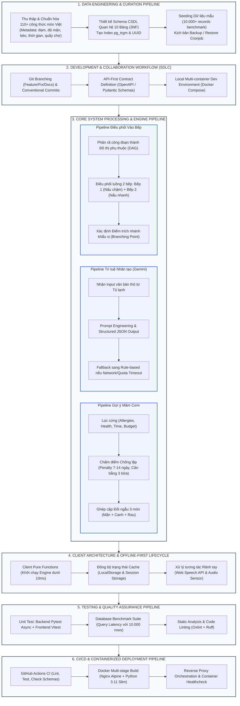

# 🍲 DailyMeal – "Hôm Nay Ăn Gì?"
### Trợ lý Lập Mâm Cơm Gia Đình & Điều Phối Nấu Ăn Thông Minh Tích Hợp AI

[](https://fastapi.tiangolo.com/)
[](https://react.dev/)
[](https://tailwindcss.com/)
[](https://www.postgresql.org/)
[](https://ai.google.dev/)
[](https://www.docker.com/)

---

## 📖 MỤC LỤC
1. [Giới Thiệu & Mô Tả Chi Tiết Dự Án](#1-giới-thiệu--mô-tả-chi-tiết-dự-án)
   - [1.1. Bối cảnh & Vấn đề thực tiễn (Problem Statement)](#11-bối-cảnh--vấn-đề-thực-tiễn-problem-statement)
   - [1.2. Mục tiêu & Sứ mệnh giải quyết (Vision & Objectives)](#12-mục-tiêu--sứ-mệnh-giải-quyết-vision--objectives)
   - [1.3. 4 Phân hệ chức năng cốt lõi (Core Subsystems)](#13-4-phân-hệ-chức-năng-cốt-lõi-core-subsystems)
2. [Workflow Làm Việc Kỹ Thuật Của Dự Án (Project Engineering & Operational Workflow)](#2-workflow-làm-việc-kỹ-thuật-của-dự-án-project-engineering--operational-workflow)
   - [2.1. Sơ đồ tổng thể Workflow làm việc dự án](#21-sơ-đồ-tổng-thể-workflow-làm-việc-dự-án)
   - [2.2. Chi tiết 7 giai đoạn trong Workflow làm việc](#22-chi-tiết-7-giai-đoạn-trong-workflow-làm-việc)
3. [Đề Xuất Frameworks & Công Nghệ Cho Từng Mục Trong Workflow](#3-đề-xuất-frameworks--công-nghệ-cho-từng-mục-trong-workflow)
   - [Bảng đối chiếu & Lựa chọn công nghệ chi tiết](#bảng-đối-chiếu--lựa-chọn-công-nghệ-chi-tiết)
4. [Kiến Trúc Kỹ Thuật Hệ Thống (System Architecture)](#4-kiến-trúc-kỹ-thuật-hệ-thống-system-architecture)
5. [Cấu Trúc Thư Mục Dự Án (Project Directory Structure)](#5-cấu-trúc-thư-mục-dự-án-project-directory-structure)
6. [Hướng Dẫn Cài Đặt & Khởi Chạy Nhanh (Quick Start Guide)](#6-hướng-dẫn-cài-đặt--khởi-chạy-nhanh-quick-start-guide)

---

## 1. GIỚI THIỆU & MÔ TẢ CHI TIẾT DỰ ÁN

### 1.1. Bối cảnh & Vấn đề thực tiễn (Problem Statement)

Bữa cơm gia đình đóng vai trò hạt nhân trong đời sống văn hóa Việt Nam, là sợi dây gắn kết các thế hệ sau một ngày học tập và làm việc. Tuy nhiên, trong nhịp sống đô thị hiện đại, việc chuẩn bị một bữa cơm nhà ấm cúng, đủ chất đang trở thành áp lực đè nặng lên người nội trợ, xuất phát từ **5 rào cản nhức nhối**:

1. **Tê liệt ra quyết định (Decision Fatigue):**
   - Sau 8–10 tiếng lao động trí óc căng thẳng, câu hỏi quen thuộc *"Hôm nay ăn gì?"* biến thành gánh nặng tâm lý. Người dùng thường rơi vào vòng lặp hỏi – đáp mơ hồ (*"Ăn gì cũng được"*), mất từ 15 đến 30 phút lướt điện thoại nhưng vẫn bế tắc, dẫn đến gọi đồ ăn nhanh nhiều dầu mỡ hoặc ăn uống qua loa.
2. **Sự bất cập của các ứng dụng ẩm thực hiện nay (Recipe Discovery vs. Meal Balancing):**
   - Các ứng dụng ẩm thực phổ biến (Cookpad, Yummly, Tasty,...) chỉ là kho lưu trữ các **công thức món ăn đơn lẻ (Single Dish)** theo kiểu phương Tây. 
   - Chúng hoàn toàn bỏ qua cấu trúc đặc thù của **mâm cơm Việt Nam** — vốn là sự phối hợp hài hòa mang tính đối ngẫu giữa:  
     $$\text{Mâm Cơm Việt} = [\text{Món Mặn/Đậm đà}] + [\text{Món Canh/Thanh nhiệt}] + [\text{Món Rau/Chống ngấy}]$$
   - Không có công cụ nào giúp tự động ghép cặp dinh dưỡng: ví dụ khi ăn *Thịt kho tàu (béo, đậm vị)* thì canh phải là *Canh cải ngọt / Canh chua (thanh mát, giải ngấy)* và rau phải là *Dưa chua / Rau luộc*, chứ không thể ghép với canh béo ngậy hay đồ chiên ngập dầu.
3. **Lãng phí thực phẩm & Tủ lạnh quá tải (Food Waste & Fridge Blindness):**
   - Người tiêu dùng đi chợ ngẫu hứng, mua sắm không theo lộ trình quầy hàng dẫn đến mua trùng lặp hoặc mua dư thừa.
   - Nguyên liệu tích trữ trong tủ lạnh thường bị bỏ quên dưới đáy ngăn mát cho tới khi thối hỏng. Người dùng không biết cách kết hợp những mẩu nguyên liệu thừa lẻ tẻ còn sót lại thành một bữa cơm hoàn chỉnh.
4. **Nấu ăn tuần tự tốn thời gian (> 60 phút):**
   - Người nấu thiếu kỹ năng lập kế hoạch thao tác, thường chế biến tuần tự từng món: nấu xong món mặn mới bật bếp nấu canh, nấu canh xong mới xào rau. Thời gian chết (idle time) kéo dài khiến bữa nấu tốn hơn 1 giờ đồng hồ và các món ăn khi dọn lên mâm bị nguội tanh.
5. **Xung đột khẩu vị đa thế hệ (Multi-generational Taste Conflict):**
   - Một gia đình 2–3 thế hệ có nhu cầu dinh dưỡng hoàn toàn đối lập: Trẻ nhỏ không ăn được cay và sợ hóc xương dăm; người cao tuổi bị cao huyết áp cần ăn nhạt, thịt mềm; người trưởng thành lại chuộng vị đậm đà, tiêu ớt nồng nàn. Người nội trợ không thể nấu 2–3 mâm cơm riêng biệt vì kiệt sức.

---

### 1.2. Mục tiêu & Sứ mệnh giải quyết (Vision & Objectives)

**DailyMeal (SmartKitchen)** định vị là **Trợ lý ẩm thực đồng hành trọn chu trình** dành cho gia đình Việt, mang đến giải pháp công nghệ toàn diện từ lúc nảy sinh nhu cầu đến khi mâm cơm nóng hổi được dọn lên bàn:

* ⏱️ **Quyết định siêu tốc (< 30 giây):** Xóa bỏ tê liệt lựa chọn bằng thuật toán sinh 3 combo mâm cơm tối ưu sẵn (Đậm đà / Thanh mát / Siêu tốc). Không bắt người dùng tìm kiếm giữa hàng nghìn món hỗn loạn.
* 🥗 **Chuẩn vị mâm cơm Việt & Chống ngán:** Tự động ghép nối quy tắc đối ngẫu ẩm thực Việt, kiểm soát cửa sổ 14 ngày không lặp món mặn và cân bằng 3 bữa gần nhất không trùng lặp nguồn đạm/chất béo.
* 🛒 **Đi chợ thông minh & Tiết kiệm chi phí:** Tự động gom nguyên liệu của cả mâm cơm, phân chia theo 4 quầy chợ truyền thống (*Thịt/Cá, Rau củ, Trứng/Đậu, Đồ khô/Gia vị*); đối chiếu tủ lạnh để tận dụng tối đa đồ sẵn có, giảm thiểu lãng phí thực phẩm.
* ⏱️ **Cắt giảm 50% thời gian đứng bếp (còn 25–30 phút):** Trục thời gian điều phối song song 2 bếp (Bếp 1 ninh/kho lửa nhỏ trong lúc Bếp 2 nấu canh và xào rau nhanh).
* 👨‍👩‍👧‍👦 **Hài hòa khẩu vị "Một mâm – Nhiều nhánh":** Đưa ra chỉ dẫn trích phần ăn cho trẻ nhỏ / người già trước khi nêm nếm đậm vị cho người lớn ngay trên cùng một quy trình nấu.

---

### 1.3. 4 Phân hệ chức năng cốt lõi (Core Subsystems)

| Phân hệ (Subsystem) | Tên gọi nghiệp vụ | Giá trị mang lại |
|---|---|---|
| **Subsystem 1** | **Decision Engine (Khám phá & Ra quyết định)** | Bộ lọc 3 tiêu chí (Thời gian, Ngân sách, Số người) $\rightarrow$ Sinh ngay 3 combo mâm cơm Việt; Cơ chế đổi món 1 chạm giữ cấu trúc; Mood Pivot giải cứu phân vân khi đổi món quá 3 lần. |
| **Subsystem 2** | **Smart Grocery & Rescue Fridge (Đi chợ & Cứu tủ lạnh)** | Checklist đi chợ tự động gộp định lượng; Phân bổ theo 4 quầy chợ Việt; Tính năng Cứu tủ lạnh tích hợp AI Gemini để phân tích nguyên liệu dở dang và tạo công thức tận dụng. |
| **Subsystem 3** | **Parallel Cooking Assistant (Điều phối vào bếp song song)** | Timeline biểu đồ Gantt 2 bếp song song; Chế độ nấu rảnh tay (Hands-free mode) bước-qua-bước với font to, tích hợp giọng nói (Voice Command) & Bộ đếm giờ Timer; Cẩm nang cứu món khẩn cấp (quá mặn, quá cay, cháy đáy). |
| **Subsystem 4** | **Personalization & Nutrition (Khẩu vị & Dinh dưỡng đa thế hệ)** | Hồ sơ thành viên gia đình (dị ứng, bệnh lý, độ tuổi); Mô hình "Một mâm - Nhiều nhánh"; Ước tính dinh dưỡng vĩ mô (Kcal, Đạm, Béo, Tinh bột) và cảnh báo Natri/Đường ẩn. |

---

## 2. WORKFLOW LÀM VIỆC KỸ THUẬT CỦA DỰ ÁN (PROJECT ENGINEERING & OPERATIONAL WORKFLOW)

> ⚠️ **LƯU Ý:** Đây **KHÔNG PHẢI** là workflow hành vi của người dùng cuối (User Journey), mà là **Quy trình làm việc kỹ thuật, đường ống xử lý dữ liệu và vòng đời vận hành hệ thống phần mềm (Engineering & Data Processing Pipeline / SDLC)** của toàn bộ dự án DailyMeal.

---

### 2.1. Sơ đồ tổng thể Workflow làm việc dự án



---

### 2.2. Chi tiết 7 giai đoạn trong Workflow làm việc

#### 🔹 Mục 1: Pipeline Thu thập, Chuẩn hóa Dữ liệu & Quản trị CSDL (Data Engineering Pipeline)
* **Quy trình thu thập & gắn nhãn dữ liệu:** 
  - Khảo sát và chuẩn hóa tập dữ liệu 110+ món ăn truyền thống Việt Nam.
  - Mỗi món ăn được bóc tách thành các trường dữ liệu có cấu trúc: Nhóm món (*Mặn, Canh, Rau*), Loại đạm chính (*Heo, Bò, Gà, Cá, Tôm, Đậu phụ*), Độ mặn/béo (Thang 1–3), Thời gian nấu, Dụng cụ cần thiết, Quầy chợ phân loại (*Thịt cá, Rau củ, Gia vị, Đồ khô*), và Công đoạn nấu song song.
* **Thiết kế & Di chuyển Schema (Database Modeling & Migration):**
  - Xây dựng mô hình quan hệ chuẩn hóa bậc 3 (3NF) với 10 bảng: `users`, `family_members`, `recipes`, `ingredients`, `recipe_ingredients`, `meal_combos`, `meal_combo_recipes`, `grocery_items`, `fridge_items`, `cooking_sessions`.
  - Cài đặt extension `pg_trgm` cho tìm kiếm gần đúng tiếng Việt không dấu/có dấu và `uuid-ossp` cho định danh phi tuần tự.
* **Quy trình Seeding & Vận hành sao lưu:**
  - Viết kịch bản tự động sinh 10.000+ bản ghi giả lập cho bảng lịch sử nấu ăn và đánh giá mâm cơm nhằm phục vụ bài toán benchmark hiệu năng.
  - Thiết lập kịch bản tự động sao lưu dữ liệu định kỳ (`backup.sh` qua `pg_dump`) và kịch bản khôi phục sự cố (`restore.sh`).

#### 🔹 Mục 2: Pipeline Quy trình Phát triển phần mềm & Cộng tác (SDLC & Collaboration)
* **Mô hình phân nhánh mã nguồn (Git Workflow):**
  - Áp dụng chiến lược GitHub Flow tinh gọn: Nhánh `main` luôn ở trạng thái sẵn sàng triển khai (Production-ready). Các nhánh tính năng tuân theo quy ước: `feat/<feature-name>`, `fix/<bug-name>`, `docs/<doc-name>`.
  - Quy chuẩn thông điệp commit theo chuẩn **Conventional Commits** (`feat:`, `fix:`, `refactor:`, `test:`, `chore:`).
* **Quy ước API-First (API Contract):**
  - Định nghĩa tường minh các lược đồ dữ liệu DTO/Schemas bằng Pydantic trước khi code logic.
  - Tự động sinh tài liệu chuẩn tương tác OpenAPI / Swagger UI giúp Frontend và Backend độc lập phát triển mà không bị phụ thuộc tiến độ.
* **Đồng nhất hóa môi trường thực thi cục bộ (Local Environment):**
  - Toàn bộ đội ngũ chạy chung môi trường qua Docker Compose (PostgreSQL, Backend API, Frontend Nginx).

#### 🔹 Mục 3: Pipeline Xử lý Thuật toán Gợi ý Mâm Cơm (Deterministic Suggestion Engine)
Thuật toán hoạt động theo đường ống 4 tầng nghiêm ngặt nhằm đảm bảo tính toán thời gian thực:
1. **Tầng 1 - Hard Filter (Lọc cứng bất khả xâm phạm):**
   - Loại trừ ngay lập tức các món chứa nguyên liệu dị ứng của bất kỳ thành viên nào trong gia đình.
   - Loại trừ món không phù hợp với bệnh lý nền (VD: loại món chiên rán/nhiều đường nếu ăn kiêng, loại món mặn cấp 3 nếu cao huyết áp).
   - Lọc theo giới hạn thời gian (15p/30p/45p) và ngân sách mong muốn.
2. **Tầng 2 - Scoring & Anti-Repetition (Chấm điểm & Chống lặp):**
   - Gán điểm khởi tạo: 100 điểm.
   - Phạt cực nặng ($\text{Score} = -9999$) nếu món đã nấu trong vòng 1–7 ngày gần nhất; phạt 30 điểm nếu nấu trong vòng 8–14 ngày.
   - Kiểm tra lịch sử 3 bữa gần nhất: Phạt món béo nếu bữa trước đã ăn béo; phạt trùng lặp nguồn đạm liên tiếp; cộng điểm thưởng cho món ruột (Favorite dishes).
3. **Tầng 3 - Vietnamese Pairing Engine (Ghép cặp chuẩn vị mâm cơm Việt):**
   - Lựa chọn Món Mặn từ Top ứng viên điểm cao nhất.
   - Ghép Món Canh đối ngẫu: Mặn kho đậm đà bắt buộc đi cùng Canh rau thanh mát; tuyệt đối không trùng nguồn đạm giữa Mặn và Canh.
   - Ghép Món Rau: Bảo đảm có tối thiểu 1 món rau xanh trên mâm để cân bằng chất xơ.
4. **Tầng 4 - Format Output & Dual-mode Execution:**
   - Đóng gói thành 3 mâm cơm theo 3 phong cách: *Mâm truyền thống*, *Mâm thanh mát nhẹ bụng*, *Mâm siêu tốc 20 phút*.

#### 🔹 Mục 4: Pipeline Trí tuệ Nhân tạo & Xử lý Ngôn ngữ Tự nhiên (AI Inference Pipeline)
* **Xử lý "Cứu Tủ Lạnh" (Rescue Fridge):**
  - Nhận chuỗi văn bản tự do người dùng nhập từ tủ lạnh (Ví dụ: *"còn 2 quả trứng gà, nửa cây bắp cải trắng, 1 ít thịt nạc băm và hành lá"*).
  - Đóng gói System Prompt với tri thức văn hóa ẩm thực Việt, yêu cầu Gemini AI đóng vai chuyên gia bếp trưởng gia đình.
  - Kích hoạt chế độ **Structured Outputs (JSON Schema)** để Gemini trả về định dạng JSON chuẩn gồm: Danh sách món đề xuất, Nguyên liệu tận dụng được, Nguyên liệu cần mua bổ sung tối thiểu, và hướng dẫn chế biến nhanh.
* **Cơ chế chịu lỗi (Graceful Degradation / Fallback):**
  - Nếu kết nối mạng gián đoạn, API Key hết hạn ngạch (Quota Limit) hoặc độ trễ phản hồi $> 5\text{s}$, hệ thống tự động kích hoạt chế độ Fallback: Dùng thuật toán so khớp từ khóa cục bộ với kho 110 món có sẵn trên Client để trả kết quả tức thì.

#### 🔹 Mục 5: Pipeline Điều phối Vào Bếp Song Song & Tương tác Rảnh tay (Cooking Dispatcher)
* **Phân tích Đồ thị Công đoạn (Directed Acyclic Graph - DAG):**
  - Phân rã 3 món ăn thành tập hợp các bước sơ chế và bước nấu.
  - Sắp xếp lịch trình dựa trên 2 tài nguyên bếp độc lập:
    * **Bếp 1:** Dành cho món mặn (cần thời gian kho/om lâu 15–20 phút ở lửa nhỏ, không cần người nấu phải đứng canh liên tục).
    * **Bếp 2:** Dành cho món canh và món rau (thao tác nhanh 5–10 phút, cần lửa lớn).
  - Tự động nhận diện **Điểm trích nhánh khẩu vị (Branching Point)**: Đưa ra cảnh báo âm thanh/hình ảnh tại phút thứ 22: *"Trích một phần thịt kho mềm chưa nêm ớt/tiêu ra bát cho bé trước khi tiếp tục rim cay cho người lớn"*.
* **Tương tác rảnh tay không chạm (Hands-free Voice Interaction):**
  - Tích hợp trình xử lý giọng nói thông qua Web Speech API.
  - Bắt các khẩu lệnh cơ bản: *"Tiếp tục"*, *"Quay lại"*, *"Hẹn giờ 5 phút"*, *"Cứu món bị mặn"* $\rightarrow$ Cho phép người dùng chuyển bước nấu khi tay đang ướt hoặc dính dầu mỡ mà không cần chạm vào màn hình.

#### 🔹 Mục 6: Pipeline Kiểm thử & Đảm bảo Chất lượng (Testing & QA Pipeline)
* **Backend Automated Testing:**
  - Kiểm thử đơn vị (Unit Tests) và kiểm thử tích hợp (Integration Tests) với Pytest Asyncio.
  - Kiểm tra độ bao phủ mã nguồn (Coverage Report), kiểm tra tính hợp lệ của các schema Pydantic và route endpoints.
* **Database Benchmark & Query Plan Analysis:**
  - Chạy kịch bản kiểm thử tải truy vấn trên tập dữ liệu 10.000 bản ghi lịch sử bữa ăn.
  - Sử dụng `EXPLAIN ANALYZE` để chứng minh hiệu quả giảm thời gian tìm kiếm của Index `pg_trgm` (từ Sequential Scan sang Bitmap Index Scan).
* **Frontend Linting & Performance:**
  - Kiểm tra cú pháp và chất lượng mã nguồn bằng công cụ siêu tốc Oxlint.
  - Phân tích bundle build của Vite để đảm bảo dung lượng tải trang lần đầu (First Contentful Paint) $< 1.2\text{s}$.

#### 🔹 Mục 7: Pipeline Đóng gói, Container hóa & Triển khai (CI/CD & DevOps Pipeline)
* **Multi-stage Docker Build:**
  - Frontend: Sử dụng container `node:20-alpine` để build bundle tĩnh, sau đó copy sản phẩm sang container `nginx:alpine` siêu nhẹ ($< 30\text{MB}$) làm Web Server phục vụ static files và cấu hình Reverse Proxy cho các API endpoint.
  - Backend: Sử dụng base image `python:3.11-slim`, cài đặt dependencies từ `requirements.txt`, tối ưu hóa layer caching của Docker.
* **Điều phối & Giám sát dịch vụ (Docker Compose Orchestration):**
  - Cấu hình mạng riêng `dailymeal-net` cô lập dịch vụ cơ sở dữ liệu.
  - Thiết lập cơ chế `healthcheck` cho PostgreSQL để đảm bảo Backend chỉ khởi động khi cơ sở dữ liệu đã sẵn sàng nhận kết nối (`service_healthy`).
  - Gắn Persistent Volume `postgres_data` để bảo toàn dữ liệu khi khởi động lại container.

---

## 3. ĐỀ XUẤT FRAMEWORKS & CÔNG NGHỆ CHO TỪNG MỤC TRONG WORKFLOW

Dưới đây là bảng phân tích chi tiết và đề xuất các Frameworks, Thư viện và Công nghệ tối ưu nhất cho từng giai đoạn trong quy trình kỹ thuật của dự án:

### Bảng đối chiếu & Lựa chọn công nghệ chi tiết

| Mục trong Workflow | Thành phần kỹ thuật | Framework / Công nghệ Đề xuất | Phiên bản | Lý do đề xuất & Ưu điểm vượt trội |
|---|---|---|:---:|---|
| **1. Data Engineering & CSDL** | **Hệ quản trị CSDL quan hệ (RDBMS)** | **PostgreSQL** | `16-alpine` | • Hỗ trợ chuẩn ACID mạnh mẽ, tin cậy tuyệt đối cho dữ liệu giao dịch mâm cơm.<br>• Hỗ trợ Extension `pg_trgm` cho tìm kiếm mờ (fuzzy search) tên món ăn tiếng Việt.<br>• Hỗ trợ kiểu dữ liệu JSONB linh hoạt để lưu cấu trúc bước nấu và định lượng nguyên liệu. |
| | **Async ORM & Core Engine** | **SQLAlchemy** (Asyncio) | `2.0+` | • Chuẩn mực ORM hiện đại cho Python, hỗ trợ kiến trúc bất đồng bộ (Async/Await) kết hợp cùng driver `asyncpg` cho thông lượng truy vấn cực cao. |
| | **Database Migrations** | **Alembic** | `1.13+` | • Tự động dò tìm thay đổi trên Model SQLAlchemy và sinh kịch bản migrate phiên bản CSDL chính xác, an toàn khi cập nhật môi trường Production. |
| | **Data Validation & Parsing** | **Pydantic** | `2.7+` | • Thư viện parse và xác thực dữ liệu viết bằng ngôn ngữ Rust, tốc độ nhanh gấp 5-10 lần Pydantic v1; tương thích hoàn hảo với chuẩn OpenAPI. |
| **2. SDLC & Collaboration** | **Quản lý phiên bản mã nguồn** | **Git & GitHub** | - | • Hỗ trợ quản lý phân nhánh, Review Code qua Pull Requests và quản lý Tasks qua GitHub Projects. |
| | **Đặc tả giao tiếp API Contract** | **OpenAPI Specification (Swagger UI)** | `v3.1` | • Tự động sinh tài liệu API tương tác trực tiếp từ code FastAPI tại đường dẫn `/docs` và `/redoc`, giúp Frontend phát triển độc lập không phụ thuộc Backend. |
| | **Quy chuẩn mã nguồn** | **Conventional Commits & Commitlint** | - | • Chuẩn hóa lịch sử commit giúp tự động sinh Changelog và dễ dàng tra cứu lịch sử thay đổi tính năng. |
| **3. Core Engine & Backend** | **Web Framework Backend** | **FastAPI** | `0.115+` | • Hiệu năng dẫn đầu hệ sinh thái Python (ngang ngửa Go và NodeJS nhờ kiến trúc Starlette/Pydantic).<br>• Tích hợp native Async/Await xử lý đồng thời hàng nghìn kết nối non-blocking.<br>• Tự động sinh Schema và tài liệu OpenAPI 100%. |
| | **Máy chủ ứng dụng (ASGI Server)** | **Uvicorn** (Standard Worker) | `0.30+` | • Máy chủ ASGI hiệu năng cao, hỗ trợ HTTP/1.1 và WebSockets với tính năng auto-reload mượt mà trong môi trường phát triển. |
| | **Async HTTP Client** | **HTTPX** | `0.27+` | • Client thực hiện các lệnh gọi HTTP bất đồng bộ ra ngoài (External API Calls) mà không làm tắc nghẽn Event Loop của máy chủ. |
| **4. AI & NLP Pipeline** | **Trí tuệ nhân tạo (LLM)** | **Google Gemini API** (`google-genai`) | `gemini-1.5-flash` / `gemini-2.5-flash` | • Chi phí cực thấp, tốc độ suy luận (latency) cực nhanh thích hợp cho trải nghiệm web thời gian thực.<br>• Cửa sổ ngữ cảnh (Context Window) lớn và khả năng hiểu tiếng Việt, văn hóa ẩm thực Việt Nam xuất sắc.<br>• Hỗ trợ cơ chế **Structured JSON Output** giúp trích xuất nguyên liệu tủ lạnh chuẩn xác 100%. |
| | **Structured Output Parser** | **Pydantic Structured Output** | - | • Ép buộc Gemini API trả về cấu trúc dữ liệu theo đúng Schema Pydantic đã định nghĩa, loại bỏ hoàn toàn lỗi hallucination làm vỡ giao diện. |
| **5. Frontend & Client Engine** | **Thư viện UI chính** | **React** | `19.2+` | • Thư viện UI phổ biến nhất thế giới với hệ sinh thái component khổng lồ.<br>• Kiến trúc Hook và Component tái sử dụng cao, tối ưu khả năng render mâm cơm và dòng thời gian nấu. |
| | **Frontend Build Tool** | **Vite** | `6.x` / `8.x` | • Tốc độ khởi động máy chủ phát triển trong vài mili-giây nhờ ES Modules bản địa; quá trình đóng gói production bundle siêu tối ưu. |
| | **CSS / Design System Framework** | **Tailwind CSS** | `v4.0+` | • CSS Utility-first thế hệ mới với Engine Oxide viết bằng Rust, build cực nhanh, cấu hình tối giản, thiết kế Responsive mobile-first chuẩn mực cho giao diện nhà bếp. |
| | **State Management & Caching** | **React Custom Hooks + LocalStorage/IndexedDB** | - | • Kiến trúc Offline-first: Cho phép chạy thuật toán gợi ý mâm cơm ngay trên trình duyệt mà không cần internet, lưu trữ lịch sử chốt mâm 14 ngày an toàn. |
| | **Xử lý giọng nói rảnh tay** | **Web Speech API** (Browser Native) | - | • API bản địa có sẵn trên trình duyệt Chrome/Safari, không tốn thêm chi phí thuê dịch vụ ngoài, nhận diện khẩu lệnh trực tiếp để chuyển bước nấu. |
| | **Iconography & Visual Effects** | **Lucide React & Canvas-Confetti** | Mới nhất | • Bộ icon giao diện sắc nét, tối giản; hiệu ứng pháo hoa ăn mừng khi chốt mâm cơm tạo cảm giác hoàn thành mục tiêu (gamification). |
| **6. Testing & Quality Assurance** | **Backend Testing Framework** | **Pytest & Pytest-Asyncio** | `8.2+` | • Framework kiểm thử tiêu chuẩn số 1 của Python; hỗ trợ fixtures mạnh mẽ và kiểm thử các hàm coroutine bất đồng bộ. |
| | **Frontend Testing & Linter** | **Oxlint** & **Vitest** | `1.81+` | • Oxlint: Linter thế hệ mới bằng Rust, kiểm tra lỗi mã nguồn JavaScript/React nhanh gấp 50–100 lần so với ESLint truyền thống. |
| | **Kiểm thử hiệu năng CSDL** | **Custom Benchmark Scripts / pgbench** | - | • Đo đạc chỉ số thời gian truy vấn (Latency) và số truy vấn mỗi giây (QPS) trên tập dữ liệu 10.000 bản ghi để chứng minh luận điểm đồ án. |
| **7. DevOps, Container & Deploy** | **Container Engine & Orchestration** | **Docker & Docker Compose** | `v2.x` | • Đóng gói trọn gói toàn bộ hệ thống gồm 3 tầng: Frontend, Backend, Database trong một file `docker-compose.yml`, khởi chạy bằng 1 lệnh duy nhất. |
| | **Web Server & Reverse Proxy** | **Nginx** | `Alpine` | • Web Server tĩnh hiệu năng cao, chiếm cực ít RAM ($< 15\text{MB}$), cấu hình Reverse Proxy chuyển tiếp an toàn các request `/api/` tới Backend. |
| | **Tự động hóa CI/CD** | **GitHub Actions** | - | • Tự động kích hoạt luồng kiểm tra linter, chạy test suite và build thử nghiệm Docker Image mỗi khi có Pull Request được tạo. |
| | **Nền tảng Hosting mục tiêu** | **Docker VPS / Render / Vercel** | - | • Khả năng triển khai linh hoạt: có thể chạy nguyên khối qua VPS Linux hoặc tách biệt Frontend lên Vercel và Backend lên Render. |

---

## 4. KIẾN TRÚC KỸ THUẬT HỆ THỐNG (SYSTEM ARCHITECTURE)

Hệ thống được thiết kế theo mô hình kiến trúc phân tầng (Multi-tier Containerized Architecture), bảo đảm phân tách trách nhiệm (Separation of Concerns) và khả năng mở rộng linh hoạt:

```
+-----------------------------------------------------------------------------------+
|                           CLIENT TIER (Trình duyệt Người dùng)                     |
|  - Desktop / Mobile Browser (Mobile-First UI)                                     |
|  - Offline-first Suggestion Engine (Client-side Pure Functions < 10ms)             |
|  - Web Speech API (Voice Recognition Hands-free)                                  |
|  - LocalStorage / Client State Manager (Lịch sử 14 ngày, Hồ sơ khẩu vị)           |
+-----------------------------------------------------------------------------------+
                                        │  HTTP / HTTPS (Port 13000)
                                        ▼
+-----------------------------------------------------------------------------------+
|                        FRONTEND SERVICE (Nginx Reverse Proxy)                     |
|  - Nginx 1.25 Alpine Web Server                                                   |
|  - Phục vụ Static SPA Bundle (React 19, Vite, Tailwind CSS v4)                    |
|  - Reverse Proxy: Chuyển tiếp các request /api/v1/* sang Backend:8000            |
+-----------------------------------------------------------------------------------+
                                        │  Proxy Pass (Internal Network)
                                        ▼
+-----------------------------------------------------------------------------------+
|                       BACKEND APPLICATION SERVICE (FastAPI)                       |
|  - Uvicorn ASGI Server (Port 8000)                                                |
|  - FastAPI RESTful Routers:                                                       |
|      • /api/v1/meals: Gợi ý mâm cơm, đổi món, chốt mâm                           |
|      • /api/v1/grocery: Gom chợ theo 4 quầy, quy đổi định lượng                   |
|      • /api/v1/cooking: Điều phối timeline song song 2 bếp                        |
|      • /api/v1/ai: Tích hợp Gemini cứu tủ lạnh & xử lý ngôn ngữ tự nhiên          |
|      • /api/v1/reports: Báo cáo phân tích dữ liệu chuyên sâu                      |
|  - SQLAlchemy 2.0 Async ORM Engine + Pydantic v2 Serialization                   |
+-----------------------------------------┬-----------------------------------------+
                                          │                                   │ Outbound HTTPS
             Asyncpg Connection Pool (5432)│                                   ▼
                                          ▼                  +--------------------------------+
+----------------------------------------------------+       |      EXTERNAL CLOUD AI         |
|             DATABASE SERVICE (PostgreSQL 16)       |       |  Google Gemini API             |
|  - Persistent Storage: postgres_data volume        |       |  (gemini-1.5 / 2.5 Flash)      |
|  - Extensions: uuid-ossp, pg_trgm                  |       |  - Phân tích tủ lạnh           |
|  - 10 Bảng chuẩn hóa 3NF                           |       |  - Cứu món khẩn cấp            |
|  - Dữ liệu chuẩn 110+ món ăn & 10.000+ benchmark   |       +--------------------------------+
+----------------------------------------------------+
```

---

## 5. CẤU TRÚC THƯ MỤC DỰ ÁN (PROJECT DIRECTORY STRUCTURE)

```
DailyMeal/
├── docker-compose.yml              # Cấu hình khởi chạy trọn gói 3 dịch vụ (DB, Backend, Frontend)
├── .env.example                    # Mẫu cấu hình biến môi trường
├── .gitignore                      # Cấu hình bỏ qua tệp tin theo dõi Git
├── README.md                       # Tài liệu tổng quan dự án và đặc tả kỹ thuật
│
├── frontend/                       # Phân hệ Giao diện Người dùng (React 19 + Vite)
│   ├── Dockerfile                  # Multi-stage Docker build với Nginx Alpine
│   ├── nginx.conf                  # Cấu hình Nginx Web Server & Reverse Proxy
│   ├── package.json                # Dependencies: React 19, Lucide, TailwindCSS v4, Confetti
│   ├── vite.config.js              # Cấu hình Vite bundler
│   └── src/
│       ├── components/             # Các thành phần giao diện (UI Components)
│       │   ├── HomePage.jsx        # Màn hình khám phá 3 mâm cơm & KPI đếm ngược 30s
│       │   ├── GroceryPage.jsx     # Màn hình đi chợ 4 quầy & Cứu tủ lạnh
│       │   ├── CookPage.jsx        # Màn hình điều phối vào bếp song song & rảnh tay
│       │   ├── FamilyPage.jsx      # Quản lý hồ sơ thành viên & khẩu vị
│       │   ├── MoodPivotSheet.jsx  # Bộ giải cứu phân vân khi đổi món quá 3 lần
│       │   └── ConfirmedMealView.jsx # Giao diện chúc mừng chốt mâm thành công
│       ├── logic/
│       │   └── suggestionEngine.js # Engine gợi ý thuần Pure Function chạy trên Client (< 10ms)
│       ├── data/
│       │   └── mealsData.js        # Kho dữ liệu tĩnh 110 món cơm Việt chuẩn bị
│       └── utils/
│           └── storage.js          # Tiện ích đọc/ghi bộ nhớ LocalStorage an toàn
│
├── backend/                        # Phân hệ Máy chủ Dịch vụ & API (FastAPI)
│   ├── Dockerfile                  # Docker build tối ưu cho Python 3.11 Slim
│   ├── requirements.txt            # Thư viện Python: FastAPI, SQLAlchemy, Asyncpg, Gemini
│   └── app/
│       ├── main.py                 # Điểm khởi động ứng dụng FastAPI & Cấu hình CORS
│       ├── core/
│       │   ├── config.py           # Cấu hình Pydantic Settings đọc biến môi trường
│       │   └── database.py         # Khởi tạo Async Engine & Sessionmaker
│       ├── api/v1/
│       │   ├── api.py              # Đăng ký tập trung các Router v1
│       │   └── endpoints/
│       │       ├── meals.py        # API sinh combo mâm cơm, đổi món, chốt mâm
│       │       ├── grocery.py      # API gom nguyên liệu theo quầy chợ
│       │       ├── cooking.py      # API điều phối timeline nấu ăn song song
│       │       ├── ai.py           # API kết nối Google Gemini cứu tủ lạnh
│       │       └── reports.py      # API truy vấn thống kê dữ liệu đồ án
│       ├── models/                 # Mô hình bảng CSDL SQLAlchemy (ORM)
│       ├── schemas/                # Lược đồ Pydantic kiểm thực dữ liệu vào/ra
│       └── services/               # Lớp xử lý logic nghiệp vụ và tính toán thuật toán
│
├── database/                       # Phân hệ Cơ sở Dữ liệu (PostgreSQL 16)
│   ├── init.sql                    # Script khởi tạo Extension: uuid-ossp, pg_trgm
│   ├── scripts/
│   │   ├── backup.sh               # Kịch bản sao lưu tự động (pg_dump)
│   │   └── restore.sh              # Kịch bản khôi phục dữ liệu từ bản sao lưu
│   ├── seeds/                      # Kịch bản nạp dữ liệu mẫu (10.000+ records)
│   └── benchmarks/                 # Kịch bản đo lường hiệu năng truy vấn chỉ mục
│
├── docs/                           # Tài liệu thiết kế hệ thống chi tiết
│   ├── task_tracking_sheet.md      # Sheet phân công & theo dõi tiến độ chi tiết từng thành viên
│   ├── workflow.md                 # Đặc tả 7 Workflow kỹ thuật & Mermaid Diagrams
│   ├── database_erd.md             # Thiết kế chi tiết 10 bảng CSDL quan hệ
│   └── hom_nay_an_gi_mvp.md        # Bản phân tích sản phẩm và yêu cầu nghiệp vụ
└── more/                           # Hồ sơ đăng ký đề tài & Phân công nhiệm vụ nhóm
    └── BAN_DANG_KY_DE_TAI.md       # Bản đăng ký đề tài đồ án chuyên ngành
```

---

## 6. HƯỚNG DẪN CÀI ĐẶT & KHỞI CHẠY NHANH (QUICK START GUIDE)

Hệ thống được đóng gói hoàn chỉnh bằng Docker Compose, cho phép thiết lập toàn bộ môi trường chỉ với một vài thao tác đơn giản.

### 6.1. Yêu cầu tiên quyết
* Đã cài đặt **Git** trên máy tính.
* Đã cài đặt **Docker** (phiên bản $\ge 24.0$) và **Docker Compose** (phiên bản $\ge 2.20$).

---

### 6.2. Các bước triển khai qua Docker Compose (Khuyến nghị)

**Bước 1: Sao chép mã nguồn về máy**
```bash
git clone https://github.com/AnhTuan-HUS/DailyMeal.git
cd DailyMeal
```

**Bước 2: Cấu hình biến môi trường**
Sao chép tệp mẫu `.env.example` thành `.env` và điền khóa API Google Gemini (nếu có):
```bash
cp .env.example .env
```
*Chỉnh sửa file `.env` nếu cần:*
```env
# Môi trường
ENVIRONMENT=development
DEBUG=true

# Cơ sở dữ liệu PostgreSQL
POSTGRES_USER=dailymeal_user
POSTGRES_PASSWORD=dailymeal_secret_password
POSTGRES_DB=dailymeal_db
POSTGRES_PORT=15432

# Cổng dịch vụ
BACKEND_PORT=18000
FRONTEND_PORT=13000

# Google Gemini API Key (dùng cho tính năng Cứu Tủ Lạnh)
GEMINI_API_KEY=your_actual_gemini_api_key_here
```

**Bước 3: Khởi chạy toàn bộ hệ thống**
```bash
docker compose up -d --build
```

**Bước 4: Kiểm tra trạng thái các Container**
```bash
docker compose ps
```
Khi cả 3 container (`dailymeal-db`, `dailymeal-backend`, `dailymeal-frontend`) đều ở trạng thái `Up / healthy`, hệ thống đã sẵn sàng phục vụ.

---

### 6.3. Truy cập các cổng dịch vụ

| Dịch vụ | Địa chỉ truy cập | Ghi chú |
|---|---|---|
| 🌐 **Frontend Web App** | [http://localhost:13000](http://localhost:13000) | Giao diện người dùng chính (Mobile & Desktop) |
| 🔌 **Backend REST API** | [http://localhost:18000](http://localhost:18000) | Điểm truy cập API gốc |
| 📚 **Swagger UI (Interactive Docs)** | [http://localhost:18000/docs](http://localhost:18000/docs) | Tài liệu kiểm thử API trực quan tự động |
| 📖 **ReDoc Documentation** | [http://localhost:18000/redoc](http://localhost:18000/redoc) | Tài liệu kỹ thuật chi tiết chuẩn OpenAPI |
| 🗄️ **PostgreSQL Database** | `localhost:15432` | Kết nối bằng DBeaver / pgAdmin với thông tin trong `.env` |

---

### 6.4. Các lệnh quản trị & vận hành thường dùng

* **Xem nhật ký log thời gian thực:**
  ```bash
  docker compose logs -f backend
  ```
* **Sao lưu cơ sở dữ liệu PostgreSQL:**
  ```bash
  ./database/scripts/backup.sh
  ```
* **Khôi phục cơ sở dữ liệu:**
  ```bash
  ./database/scripts/restore.sh ./database/backups/dailymeal_backup_YYYYMMDD.sql
  ```
* **Dừng toàn bộ hệ thống:**
  ```bash
  docker compose down
  ```

---

## 👥 THÀNH VIÊN THỰC HIỆN ĐỀ TÀI

| STT | Họ và Tên | Vai trò chính trong dự án | Trách nhiệm chính phụ trách |
|:---:|---|---|---|
| **1** | **Trưởng nhóm (Team Leader)** | System Architect & PM | Phân tích yêu cầu nghiệp vụ, thiết kế kiến trúc hệ thống, điều phối tiến độ & kiểm thử tích hợp. |
| **2** | **Backend Developer** | Backend & Database Engineer | Thiết kế CSDL PostgreSQL, phát triển RESTful API FastAPI, thuật toán gợi ý mâm cơm & tích hợp Gemini AI. |
| **3** | **Frontend Developer 1** | UI/UX & Frontend Engineer | Phát triển giao diện chuẩn Responsive, Phân hệ Ra quyết định mâm cơm (< 30s) & Phân hệ Đi chợ 4 quầy. |
| **4** | **Frontend Developer 2** | Interactive & Client State Engineer | Phát triển Phân hệ Điều phối vào bếp song song 2 bếp, chế độ rảnh tay Web Speech API & Cá nhân hóa khẩu vị. |

---
*Dự án được xây dựng và phát triển phục vụ học phần Đồ án Công nghệ phần mềm & Cơ sở dữ liệu Web 2026.*
