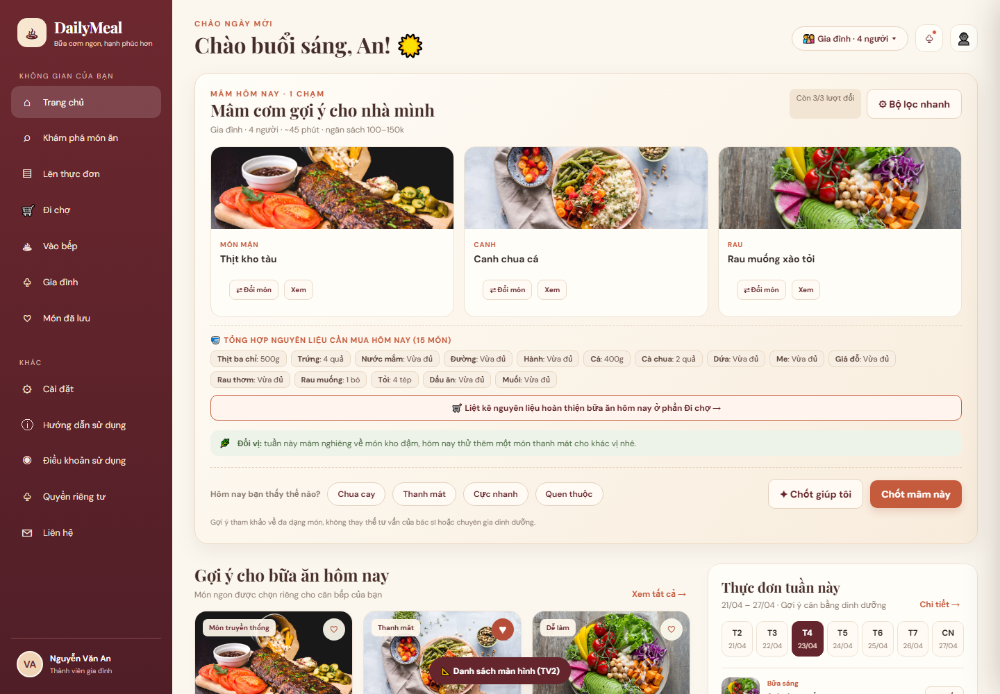
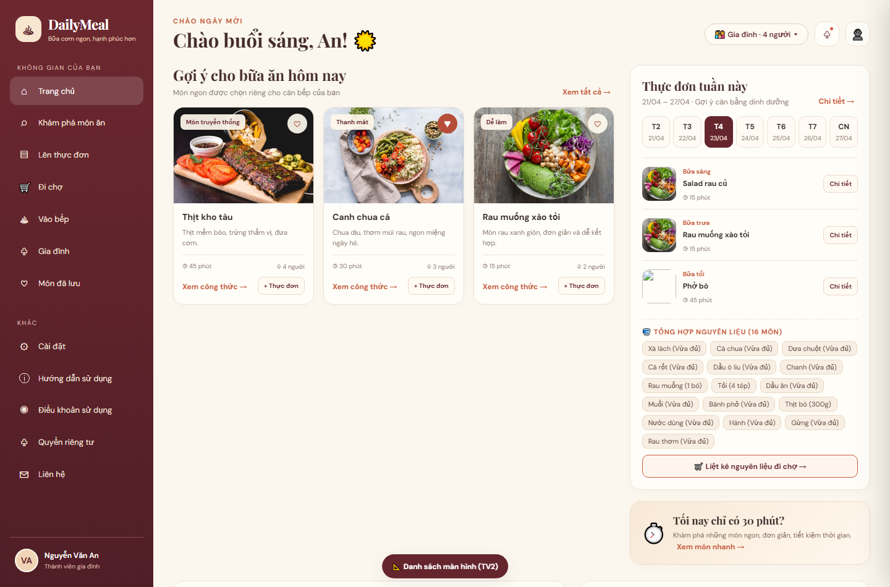
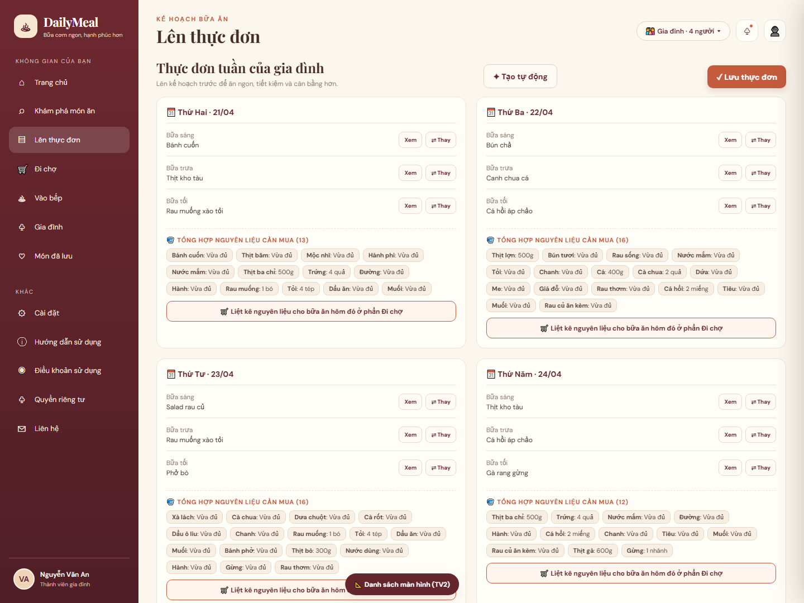
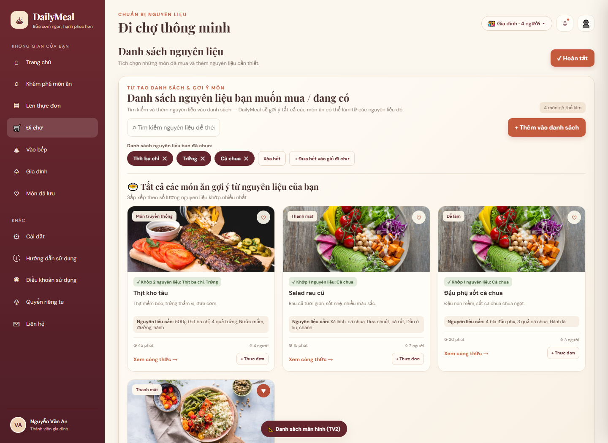
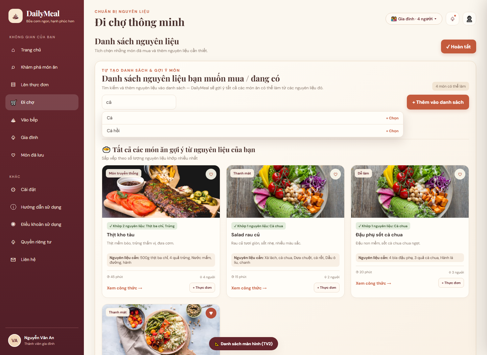

# Báo cáo đối chiếu chức năng giao diện

## Frontend DailyMeal — “Hôm nay nhà mình ăn gì?”

---

## I. TỔNG QUAN CẤU TRÚC GIAO DIỆN & ĐIỀU HƯỚNG

Giao diện tổ chức theo SPA multi-page: sidebar desktop . Luồng chính theo Kitchen Loop: Quyết định → Đi chợ → Vào bếp → Ghi nhận lịch sử.

### I.1. Khung bố cục chính

- Sidebar trái: Brand DailyMeal + 7 mục + 5 mục + avatar.

- Main: Topbar (eyebrow, tiêu đề, thông báo, tài khoản, chip chế độ) + page-view.

### I.2. Danh sách tab / trang

- Trang chủ (home) — Mâm hôm nay + gợi ý + preview tuần + shopping + gia đình.

- Khám phá món ăn (recipes) — Catalog + tìm kiếm + lọc.

    

- Lên thực đơn (plan) — Kế hoạch 7 ngày × 3 bữa.

    

- Đi chợ (shopping) — Checklist theo quầy + cứu tủ lạnh + Zalo.

    

- Vào bếp (cook) — Gantt 2 bếp + chi tiết công thức + hands-free.

    

- Gia đình (family) — Thành viên / Hồ sơ bữa ăn / Lịch sử 7 ngày.

    

- Món đã lưu (saved) — Bộ sưu tập yêu thích + chip lọc.

    

## II. PHÂN HỆ ĐĂNG NHẬP / ONBOARDING / TÀI KHOẢN

### II.1. Đăng nhập / Đăng ký / Quên mật khẩu

- Auth overlay full-screen với brand + form.

- Đăng nhập: email, mật khẩu, Ghi nhớ tôi, Quên mật khẩu, Tiếp tục với Google (UI).

- Validate: định dạng email, mật khẩu ≥ 6 ký tự.

### II.2. Menu tài khoản & thông báo

- Nút 👤: Hồ sơ, Chế độ sử dụng, Cài đặt, Hướng dẫn, Đăng xuất.

- Drawer Thông báo: chốt mâm, danh sách chợ, hỏi hôm qua có nấu, gợi ý đổi vị.

## III. TRANG CHỦ — MÂM HÔM NAY (LÕI RA QUYẾT ĐỊNH \< 30s)

Phân hệ Must Have quan trọng nhất. UI hiện thực "Mâm 1 chạm" ngay trang chủ.

### III.1. Hero & tìm kiếm nhanh

- Hero: slogan "Hôm nay nhà mình ăn gì?", ô tìm → tab Khám phá.

- Quick-links: Lên thực đơn / Đi chợ / Vào bếp / Gia đình.

### III.2. Khối "Mâm hôm nay"

- 1 mâm = MÓN MẶN + CANH + RAU (đối ngẫu Việt).

- Meta: số người, thời gian, ngân sách · Pill "Còn X/3 lượt đổi".

- Mỗi món: ⇄ Đổi món + Xem · Chip Mood · Chốt giúp tôi · Chốt mâm.

- **Tổng hợp nguyên liệu hôm nay**: Cuối khối mâm hôm nay và bảng Thực đơn tuần này trên Trang chủ hiển thị danh sách tổng hợp nguyên liệu cần mua kèm nút **“🛒 Liệt kê nguyên liệu hoàn thiện bữa ăn hôm nay ở phần Đi chợ →”** để đẩy thẳng sang phần Đi chợ.

- Banner "Đổi vị" + disclaimer dinh dưỡng.

### III.3. Luồng đổi món (Swap ≤ 3)

- Lý do khách quan (hết NL / không ăn được / thiếu dụng cụ) = không tốn lượt.

- "Chán món này" = tính 1 lượt · Hết 3 lượt → gợi ý Mood / Chốt giúp tôi.

### III.4. Mood Pivot & Chốt mâm

- 4 chip: Chua cay / Thanh mát / Cực nhanh / Quen thuộc.

- Chốt → khóa mâm + modal tóm tắt + CTA Đi chợ / Vào bếp.

    

### III.5. Bộ lọc nhanh

- Số suất · Thời gian · Ngân sách · Dụng cụ có sẵn (multi-select).

## IV. KHÁM PHÁ MÓN ĂN (CATALOG)

- Toolbar: tìm kiếm, danh mục, thời gian, Bộ lọc nâng cao.

- Card: ảnh, category, heart, meta, Xem công thức, + Thực đơn.

- Modal chi tiết: nguyên liệu, bước nấu, Lưu / Thêm thực đơn / Vào bếp.

## V. LÊN THỰC ĐƠN TUẦN

- Lưới 7 ngày × 3 bữa · Mỗi slot: Xem + ⇄ Thay.

- **Tổng hợp nguyên liệu cuối mỗi thực đơn ngày**: Ở cuối mỗi thẻ thực đơn của từng ngày (Thứ Hai đến Chủ Nhật) có phần **🧺 Tổng hợp nguyên liệu cần mua**, tự động gom và cộng gộp định lượng nguyên liệu của cả 3 bữa trong ngày đó.

- **Nút chuyển nguyên liệu sang Đi chợ**: Nút **“🛒 Liệt kê nguyên liệu cho bữa ăn hôm đó ở phần Đi chợ”** ở cuối mỗi ngày giúp nạp toàn bộ nguyên liệu cần mua của ngày đó sang phần Đi chợ chỉ với 1 chạm.

- Tạo tự động: số ngày, ưu tiên, tránh lặp 7 ngày.

- Lưu thực đơn → CTA tạo danh sách đi chợ.

## VI. ĐI CHỢ (SHOPPING LIST)

- Checklist + chi phí dự kiến · Nhóm 4 quầy: Thịt & cá / Rau củ / Trứng & đậu / Gia vị & khô.

- Thêm nguyên liệu thủ công · Cứu tủ lạnh · Xuất Zalo · Hoàn tất.

- **Tự tạo danh sách nguyên liệu bằng thanh tìm kiếm**: Người dùng có thể tìm kiếm nguyên liệu (có gợi ý tự động thả xuống) và bấm **“+ Thêm vào danh sách”** để tự tạo danh sách nguyên liệu mình muốn mua hoặc đang có, hỗ trợ xóa từng món, xóa hết hoặc đồng bộ lên giỏ đi chợ.

- **Gợi ý tất cả các món ăn từ danh sách nguyên liệu tự tạo**: Từ danh sách nguyên liệu người dùng vừa tạo, hệ thống tự động lọc và gợi ý tất cả các món ăn có thể chế biến từ các nguyên liệu đó (kèm nhãn báo số lượng nguyên liệu khớp và sắp xếp ưu tiên món khớp nhiều nguyên liệu nhất lên đầu).

## VII. VÀO BẾP

### VII.1. Timeline Gantt 2 bếp

- Biểu đồ song song: Chuẩn bị / Bếp 1 / Bếp 2 / Nồi cơm · trục 0–45′.

### VII.2. Cứu món lỡ tay

- Sự cố: Mặn / Nhạt / Cháy đáy / Canh chua gắt / Thịt dai — hướng xử lý ngay.

## VIII. GIA ĐÌNH & HỒ SƠ KHẨU VỊ

- Subtabs: Thành viên / Hồ sơ bữa ăn / Lịch sử 7 ngày.

### VIII.1. Thành viên

- Card thành viên · Sửa/xóa · Thêm thành viên (tên, tuổi, thích, dị ứng).

### VIII.2. Hồ sơ bữa ăn

- Toggle: Mềm / Ít mặn / Không cay / Ít ngọt · Chip nguyên liệu loại trừ.

### VIII.3. Lịch sử 7 ngày

- Hỏi "Hôm qua có nấu không?" · Tag Đã nấu / Chưa nấu / Đã đổi món · Gợi ý đổi vị.

## IX. MÓN ĐÃ LƯU

- Chip lọc: Tất cả / Món mặn / Canh / Rau / Dưới 30 phút · Empty state khi trống.

## X. CÀI ĐẶT & TRANG PHỤ TRỢ

### X.1. Cài đặt chung

- Số người mặc định · Ngân sách · Dụng cụ · Nhắc nhở · Cỡ chữ lớn khi vào bếp.

### X.2. Hướng dẫn sử dụng

- 6 bước nhanh + FAQ (3 lượt đổi, Cứu tủ lạnh, disclaimer).

