# THIẾT KẾ CƠ SỞ DỮ LIỆU CHUYÊN SÂU 28 BẢNG (ENTERPRISE ERD SPECIFICATION)
# HỆ THỐNG: "HÔM NAY ĂN GÌ?" (DAILYMEAL / SMARTKITCHEN)

> **Học phần:** Cơ sở dữ liệu Web và Hệ thống thông tin (2026)  
> **Ngành:** Khoa học dữ liệu / Công nghệ phần mềm  
> **Quy mô CSDL:** 28 bảng chuẩn hóa 3NF, phân tách theo 7 phân hệ nghiệp vụ hoàn chỉnh  
> **Hệ quản trị CSDL:** PostgreSQL 16  

---

## I. TỔNG QUAN 7 PHÂN HỆ VÀ 28 BẢNG NGHIỆP VỤ

```
┌────────────────────────────────────────────────────────────────────────────────────────┐
│                        KIẾN TRÚC DỮ LIỆU 28 BẢNG (DAILYMEAL)                           │
├────────────────────────┬───────────────────────────────────────────────────────────────┤
│ 1. Identity & Profile  │ users, roles, user_roles, family_members,                     │
│    (5 bảng)            │ member_taste_preferences                                      │
├────────────────────────┼───────────────────────────────────────────────────────────────┤
│ 2. Health & Allergens  │ allergens, member_allergens, recipe_allergens                 │
│    (3 bảng)            │                                                               │
├────────────────────────┼───────────────────────────────────────────────────────────────┤
│ 3. Master Ingredients  │ ingredient_categories, market_stalls, ingredients,            │
│    (4 bảng)            │ ingredient_price_history                                      │
├────────────────────────┼───────────────────────────────────────────────────────────────┤
│ 4. Recipe Catalog      │ recipes, recipe_ingredients, recipe_steps,                    │
│    (5 bảng)            │ recipe_tips_rescues, user_favorite_recipes                    │
├────────────────────────┼───────────────────────────────────────────────────────────────┤
│ 5. Meal Combo & Engine │ meal_combos, meal_combo_recipes, recommendation_logs,         │
│    (4 bảng)            │ confirmed_meals                                               │
├────────────────────────┼───────────────────────────────────────────────────────────────┤
│ 6. Grocery & Fridge    │ grocery_lists, grocery_items, fridge_items,                   │
│    (4 bảng)            │ fridge_rescue_events                                          │
├────────────────────────┼───────────────────────────────────────────────────────────────┤
│ 7. Cooking & Analytics │ cooking_sessions, cooking_step_logs, meal_reviews              │
│    (3 bảng)            │                                                               │
└────────────────────────┴───────────────────────────────────────────────────────────────┘
```

---

## II. SƠ ĐỒ THỰC THỂ MỐI QUAN HỆ HOÀN CHỈNH (COMPLETE 28-TABLE ERD)

```mermaid
erDiagram
    %% ============================================================
    %% PHÂN HỆ 1: IDENTITY, PERMISSIONS & FAMILY PROFILES
    %% ============================================================
    USERS ||--o{ USER_ROLES : "có vai trò"
    ROLES ||--o{ USER_ROLES : "được gán cho"
    USERS ||--o{ FAMILY_MEMBERS : "quản lý thành viên"
    FAMILY_MEMBERS ||--o{ MEMBER_TASTE_PREFERENCES : "có sở thích vị giác"

    %% ============================================================
    %% PHÂN HỆ 2: HEALTH, ALLERGENS & DIETARY SAFETY
    %% ============================================================
    FAMILY_MEMBERS ||--o{ MEMBER_ALLERGENS : "bị dị ứng"
    ALLERGENS ||--o{ MEMBER_ALLERGENS : "áp dụng cho thành viên"
    RECIPES ||--o{ RECIPE_ALLERGENS : "chứa dị nguyên"
    ALLERGENS ||--o{ RECIPE_ALLERGENS : "có mặt trong món"

    %% ============================================================
    %% PHÂN HỆ 3: MASTER INGREDIENTS & MARKET STALLS
    %% ============================================================
    INGREDIENT_CATEGORIES ||--o{ INGREDIENTS : "phân loại"
    MARKET_STALLS ||--o{ INGREDIENTS : "bày bán tại"
    INGREDIENTS ||--o{ INGREDIENT_PRICE_HISTORY : "ghi nhận biến động giá"

    %% ============================================================
    %% PHÂN HỆ 4: RECIPE CATALOG, STEPS & TIPS
    %% ============================================================
    RECIPES ||--o{ RECIPE_INGREDIENTS : "được cấu thành từ"
    INGREDIENTS ||--o{ RECIPE_INGREDIENTS : "tham gia vào món"
    RECIPES ||--o{ RECIPE_STEPS : "gồm các bước nấu"
    RECIPES ||--o{ RECIPE_TIPS_RESCUES : "có mẹo & giải cứu"
    USERS ||--o{ USER_FAVORITE_RECIPES : "ghim món ruột"
    RECIPES ||--o{ USER_FAVORITE_RECIPES : "được yêu thích bởi"

    %% ============================================================
    %% PHÂN HỆ 5: MEAL COMBOS & RECOMMENDATION ENGINE
    %% ============================================================
    MEAL_COMBOS ||--o{ MEAL_COMBO_RECIPES : "tập hợp các món"
    RECIPES ||--o{ MEAL_COMBO_RECIPES : "đóng vai trò mặn canh rau"
    USERS ||--o{ RECOMMENDATION_LOGS : "ghi nhận phiên gợi ý"
    USERS ||--o{ CONFIRMED_MEALS : "chốt thực đơn"
    MEAL_COMBOS ||--o{ CONFIRMED_MEALS : "được người dùng chọn"

    %% ============================================================
    %% PHÂN HỆ 6: SMART GROCERY & RESCUE FRIDGE
    %% ============================================================
    CONFIRMED_MEALS ||--o{ GROCERY_LISTS : "tạo danh sách mua"
    USERS ||--o{ GROCERY_LISTS : "quản lý chuyến đi chợ"
    GROCERY_LISTS ||--o{ GROCERY_ITEMS : "gồm các mục cần mua"
    INGREDIENTS ||--o{ GROCERY_ITEMS : "tham chiếu nguyên liệu"
    MARKET_STALLS ||--o{ GROCERY_ITEMS : "phân loại theo quầy"
    USERS ||--o{ FRIDGE_ITEMS : "quản lý kho đồ tủ lạnh"
    INGREDIENTS ||--o{ FRIDGE_ITEMS : "loại thực phẩm trong tủ"
    USERS ||--o{ FRIDGE_RESCUE_EVENTS : "thực hiện cứu thực phẩm"
    FRIDGE_ITEMS ||--o{ FRIDGE_RESCUE_EVENTS : "được giải cứu"
    RECIPES ||--o{ FRIDGE_RESCUE_EVENTS : "chế biến thành món"

    %% ============================================================
    %% PHÂN HỆ 7: COOKING ASSISTANT & REVIEWS
    %% ============================================================
    USERS ||--o{ COOKING_SESSIONS : "thực hiện phiên nấu"
    CONFIRMED_MEALS ||--o{ COOKING_SESSIONS : "nấu theo thực đơn"
    COOKING_SESSIONS ||--o{ COOKING_STEP_LOGS : "ghi nhận timeline"
    RECIPES ||--o{ COOKING_STEP_LOGS : "món ăn đang nấu"
    COOKING_SESSIONS ||--o{ MEAL_REVIEWS : "được đánh giá"
    USERS ||--o{ MEAL_REVIEWS : "gửi phản hồi mâm cơm"

    %% ============================================================
    %% ĐỊNH NGHĨA TRƯỜNG DỮ LIỆU CỦA 28 THỰC THỂ
    %% ============================================================

    USERS {
        int id PK
        string email UK
        string hashed_password
        string full_name
        string phone
        string avatar_url
        string audience_group "family, student, decider"
        boolean is_active
        timestamp created_at
        timestamp updated_at
    }

    ROLES {
        int id PK
        string role_code UK "admin, content_editor, member"
        string role_name
        string description
    }

    USER_ROLES {
        int id PK
        int user_id FK
        int role_id FK
        timestamp assigned_at
    }

    FAMILY_MEMBERS {
        int id PK
        int user_id FK
        string name
        string role_name "Bố, Mẹ, Bé, Ông/Bà"
        float portion_ratio "Hệ số suất: 0.5 - 1.5"
        int spice_level "0 (Không cay) - 5 (Rất cay)"
        boolean is_child
        boolean is_elderly
        boolean need_soft_food
        boolean need_low_salt
        boolean need_low_sugar
        string dietary_notes
    }

    MEMBER_TASTE_PREFERENCES {
        int id PK
        int member_id FK
        string preference_type "like, dislike, strict_avoid"
        string food_category "seafood, pork, beef, greens, tofu"
        string note
    }

    ALLERGENS {
        int id PK
        string name UK "Hải sản, Đậu phộng, Trứng, Sữa, Đậu nành, Gluten"
        string severity_default "mild, severe"
        string description
    }

    MEMBER_ALLERGENS {
        int id PK
        int member_id FK
        int allergen_id FK
        string reaction_type "anaphylaxis, rash, digestive"
        string note
    }

    INGREDIENT_CATEGORIES {
        int id PK
        string code UK "meat, seafood, vegetables, spices, dry_goods"
        string name "Thịt gia súc/cầm, Thủy hải sản, Rau củ, Gia vị"
        string icon
    }

    MARKET_STALLS {
        int id PK
        string code UK "stall_meat, stall_fish, stall_veg, stall_spices"
        string name "Quầy thịt tươi, Quầy cá hải sản, Quầy rau, Quầy khô"
        int walk_order "Thứ tự đi chợ tối ưu: 1, 2, 3, 4"
    }

    INGREDIENTS {
        int id PK
        int category_id FK
        int stall_id FK
        string name UK
        string default_unit "g, kg, quả, bó, ml, thìa"
        float estimated_price_per_unit
        float kcal_per_100g
        int shelf_life_days
        boolean is_common_staple "Đồ thường có sẵn"
    }

    INGREDIENT_PRICE_HISTORY {
        int id PK
        int ingredient_id FK
        float recorded_price
        string market_location "Chợ truyền thống, Siêu thị"
        date recorded_date
    }

    RECIPES {
        int id PK
        int author_id FK
        string title
        string dish_type "main, soup, side"
        string emoji
        text description
        int cook_time_minutes
        string cooking_method "kho, luộc_hấp, xào, chiên_rán, canh"
        int fat_level "1 (Thấp), 2 (Vừa), 3 (Béo cao)"
        int salt_level "1 (Nhạt), 2 (Vừa), 3 (Đậm)"
        string protein_type "heo, bò, gà, cá, hải_sản, trứng, đậu, chay"
        boolean is_soft
        boolean has_soft_variant
        boolean separable_seasoning
        boolean is_spicy
        boolean separable_chili
        boolean has_small_bones
        boolean high_sugar
        int kcal
        float protein_g
        float carb_g
        float fat_g
        text sodium_note
        text branch_baby_tip
        text branch_adult_tip
        string status "published, pending_review"
        timestamp created_at
    }

    RECIPE_INGREDIENTS {
        int id PK
        int recipe_id FK
        int ingredient_id FK
        float quantity_per_serving
        string unit "g, ml, quả, tép"
        string market_unit "1 bó, 2 lạng, 1 củ"
        boolean is_pantry_staple
        string prep_note "Băm nhỏ, thái mỏng"
    }

    RECIPE_ALLERGENS {
        int id PK
        int recipe_id FK
        int allergen_id FK
    }

    RECIPE_STEPS {
        int id PK
        int recipe_id FK
        int step_order "1, 2, 3..."
        string step_title
        text step_instruction
        int duration_seconds
        int stove_index "1 (Bếp 1), 2 (Bếp 2), 0 (Sơ chế)"
        boolean is_branching_point "Thời điểm trích phần ăn"
    }

    RECIPE_TIPS_RESCUES {
        int id PK
        int recipe_id FK
        string problem_type "salty, spicy, burnt, bland, oily"
        string symptom_title "Món bị quá mặn, Cháy đáy"
        text rescue_solution "Thả khoai tây sống, thêm nước dùng"
    }

    USER_FAVORITE_RECIPES {
        int id PK
        int user_id FK
        int recipe_id FK
        timestamp created_at
    }

    MEAL_COMBOS {
        int id PK
        string title "Mâm 1 · Đậm đà truyền thống"
        string tag "Hợp cả nhà, Thanh mát, Siêu tốc"
        string tag_color
        string photo_emoji
        string theme_gradient
        int cook_time
        float estimated_price
        int match_rate "0 - 100%"
        boolean is_active
        timestamp created_at
    }

    MEAL_COMBO_RECIPES {
        int id PK
        int combo_id FK
        int recipe_id FK
        string dish_role "main, soup, side"
    }

    RECOMMENDATION_LOGS {
        int id PK
        int user_id FK
        text filters_applied_json "servings, time, budget, mood"
        text suggested_combos_json
        int decision_time_seconds "Đo KPI < 30s"
        int swap_count "Số lần đổi món"
        boolean used_mood_pivot
        string mood_pivot_tag "Chua cay, Thanh mát, Nhanh, Quen"
        timestamp created_at
    }

    CONFIRMED_MEALS {
        int id PK
        int user_id FK
        int combo_id FK
        int main_recipe_id FK
        int soup_recipe_id FK
        int side_recipe_id FK
        int servings "1, 2, 4, 6"
        string status "planned, cooked, skipped"
        timestamp confirmed_date
    }

    GROCERY_LISTS {
        int id PK
        int user_id FK
        int confirmed_meal_id FK
        string title "Đi chợ bữa tối 12/10"
        float total_estimated_cost
        float actual_spent
        boolean is_completed
        timestamp created_at
    }

    GROCERY_ITEMS {
        int id PK
        int list_id FK
        int ingredient_id FK
        int stall_id FK
        string item_name
        string quantity_display "400g, 1 bó"
        float estimated_price
        boolean is_bought "Đã nhặt giỏ"
        boolean is_have "Đã có trong tủ"
    }

    FRIDGE_ITEMS {
        int id PK
        int user_id FK
        int ingredient_id FK
        string custom_name "Thịt ba chỉ mua hôm qua"
        float quantity
        string unit
        date purchased_date
        date expiry_date
        string status "fresh, warning, expired"
        boolean is_rescued
        timestamp created_at
    }

    FRIDGE_RESCUE_EVENTS {
        int id PK
        int user_id FK
        int fridge_item_id FK
        int recipe_id FK
        float saved_value_estimate
        timestamp rescued_at
    }

    COOKING_SESSIONS {
        int id PK
        int user_id FK
        int confirmed_meal_id FK
        string status "in_progress, completed, cancelled"
        timestamp started_at
        timestamp completed_at
        int total_actual_minutes
    }

    COOKING_STEP_LOGS {
        int id PK
        int session_id FK
        int recipe_id FK
        int step_order
        int stove_index "1, 2, 0"
        int planned_seconds
        int actual_seconds
        int voice_commands_count "Số lần gọi khẩu lệnh"
        timestamp completed_at
    }

    MEAL_REVIEWS {
        int id PK
        int session_id FK
        int user_id FK
        int rating_score "1 - 5 sao"
        string salt_feedback "Vừa, Nhạt, Mặn"
        string spicy_feedback "Vừa, Thiếu cay, Quá cay"
        string portion_feedback "Đủ no, Thừa, Thiếu"
        text review_comment
        string photo_url
        timestamp created_at
    }
```



---

## III. BẢNG ĐẶC TẢ CHI TIẾT 28 BẢNG THEO 7 PHÂN HỆ

### Phân hệ 1: Quản lý Người dùng, Phân quyền & Hồ sơ Gia đình (Identity & Profiles)
1. **`users`**: Thực thể tài khoản trung tâm, hỗ trợ đa nhóm người dùng (`family`, `student`, `decider`).
2. **`roles`**: Quản lý nhóm quyền hệ thống (`admin`, `content_editor`, `member`) thỏa mãn tiêu chí đồ án $\ge 2$ nhóm quyền.
3. **`user_roles`**: Bảng trung gian quan hệ Nhiều-Nhiều ($N-N$) giữa `users` và `roles`.
4. **`family_members`**: Thành viên gia đình kèm hệ số khẩu phần ăn (`portion_ratio`) và sở thích độ cay (`spice_level`).
5. **`member_taste_preferences`**: Sở thích vị giác chi tiết của từng thành viên (thích hải sản, ghét mỡ, ăn nhạt).

### Phân hệ 2: An toàn Thực phẩm & Dị ứng (Dietary Safety & Allergens)
6. **`allergens`**: Danh mục chất gây dị ứng chuẩn (hải sản, đậu phộng, gluten, trứng, sữa...).
7. **`member_allergens`**: Quan hệ $N-N$ lưu dị ứng của từng thành viên gia đình kèm mức độ nghiêm trọng (`severity`).
8. **`recipe_allergens`**: Quan hệ $N-N$ định danh các chất dị ứng có mặt trong công thức món ăn (phục vụ lọc cứng M6).

### Phân hệ 3: Danh mục Nguyên liệu & Quầy chợ (Master Ingredients & Stalls)
9. **`ingredient_categories`**: Phân loại danh mục nguyên liệu cha-con (thịt cá, rau củ, gia vị, đồ khô).
10. **`market_stalls`**: Sơ đồ 4 quầy chợ truyền thống Việt Nam (`walk_order`: thứ tự đi chợ tối ưu tránh vòng vèo).
11. **`ingredients`**: Danh mục nguyên liệu chuẩn kèm đơn vị mua, hạn dùng và giá tham khảo.
12. **`ingredient_price_history`**: Lịch sử giá nguyên liệu theo thời gian (Bảng lớn phục vụ nghiệp vụ thống kê và bài toán Big Data $\ge 10.000$ dòng).

### Phân hệ 4: Kho Công thức & Chi tiết Nấu nướng (Recipe Catalog)
13. **`recipes`**: Công thức món ăn Việt với toàn bộ nhãn dinh dưỡng định tính (`fat_level`, `salt_level`, `protein_type`, `cooking_method`).
14. **`recipe_ingredients`**: Định lượng nguyên liệu chi tiết cho 1 suất ăn và đơn vị mua thực tế tại chợ.
15. **`recipe_steps`**: Từng bước nấu ăn gắn với trục Bếp 1, Bếp 2 và điểm trích nhánh nêm gia vị (`is_branching_point`).
16. **`recipe_tips_rescues`**: Cẩm nang cứu món khẩn cấp liên kết trực tiếp với món ăn (mặn, cay, cháy, nhạt, nhiều dầu).
17. **`user_favorite_recipes`**: Quan hệ $N-N$ lưu danh sách món ruột đã ghim của người dùng.

### Phân hệ 5: Mâm cơm & Động cơ Gợi ý (Meal Combos & Recommendation Engine)
18. **`meal_combos`**: Bộ mâm cơm hoàn chỉnh 3 món (Mặn, Canh, Rau) theo chủ đề truyền thống / thanh mát / siêu tốc.
19. **`meal_combo_recipes`**: Quan hệ $N-N$ gắn kết món ăn vào vị trí slot (`main`, `soup`, `side`) của mâm cơm.
20. **`recommendation_logs`**: Nhật ký toàn diện của thuật toán gợi ý (lưu JSON bộ lọc, thời gian chốt, số lần đổi, việc dùng Mood Pivot). Bảng lớn phục vụ phân tích hành vi người dùng.
21. **`confirmed_meals`**: Mâm cơm người dùng đã chính thức chốt, là nguồn dữ liệu cho luật chống lặp 7–14 ngày.

### Phân hệ 6: Đi chợ Thông minh & Quản lý Tủ lạnh (Smart Grocery & Fridge)
22. **`grocery_lists`**: Danh sách các chuyến đi chợ phát sinh từ mâm cơm đã chốt.
23. **`grocery_items`**: Từng món hàng cần mua, tự động gộp định lượng và phân chia theo quầy chợ Việt Nam.
24. **`fridge_items`**: Kho thực phẩm có sẵn trong tủ lạnh gia đình, quản lý hạn dùng (`status: fresh/warning/expired`).
25. **`fridge_rescue_events`**: Ghi nhận các sự kiện giải cứu thực phẩm sắp hết hạn thành công, ước tính số tiền tiết kiệm được.

### Phân hệ 7: Điều phối Vào bếp & Đánh giá Bữa ăn (Cooking Assistant & Analytics)
26. **`cooking_sessions`**: Buổi nấu ăn gia đình, đo thời gian thực tế so với thời gian dự kiến.
27. **`cooking_step_logs`**: Chi tiết thời gian nấu thực tế từng bước trên từng bếp, ghi nhận số lần ra lệnh giọng nói (*Voice Commands*).
28. **`meal_reviews`**: Bảng đánh giá bữa ăn sau khi hoàn tất (chấm điểm 1–5 sao, phản hồi độ mặn, độ cay, lượng thức ăn).

---

## IV. CÁC TRUY VẤN VÀ BÁO CÁO NGHIỆP VỤ NỔI BẬT TRÊN CSDL

1. **Báo cáo 1: Thống kê hiệu quả chống lãng phí thực phẩm (Rescue Fridge Report)**  
   Truy vấn tổng hợp số nguyên liệu được cứu từ `fridge_rescue_events` và tổng giá trị quy đổi VND tiết kiệm được trong tháng.
2. **Báo cáo 2: Phân tích thời gian ra quyết định & Tỷ lệ dùng Mood Pivot (Decision KPI Report)**  
   Truy vấn từ `recommendation_logs` tính thời gian trung vị (median) từ lúc mở app đến khi chốt, đo tỷ lệ chốt mâm đạt chuẩn $\le 30$ giây.
3. **Báo cáo 3: Biến động giá thị trường nguyên liệu (Market Price Trend Analysis)**  
   Truy vấn tổng hợp trên `ingredient_price_history` $(\ge 10.000$ records) theo tháng/quý để cảnh báo các món ăn tăng chi phí.
4. **Báo cáo 4: Tỷ lệ tuân thủ trục thời gian nấu song song 2 bếp**  
   Truy vấn so sánh giữa `recipe_steps.duration_seconds` và `cooking_step_logs.actual_seconds` để đánh giá độ chính xác của timeline nấu 2 bếp.
