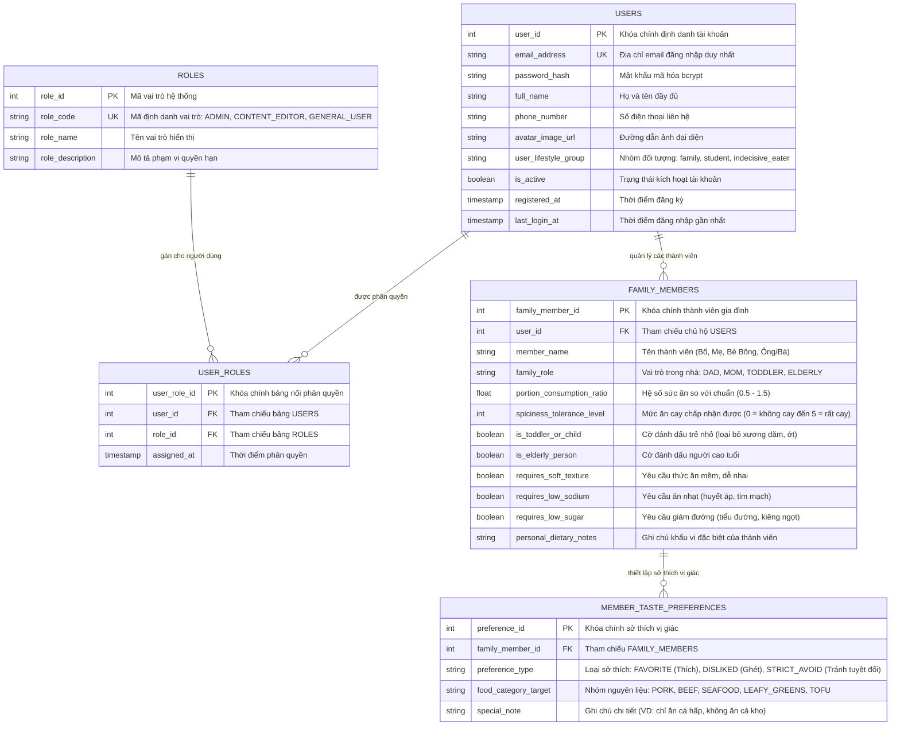
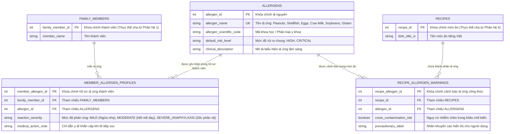
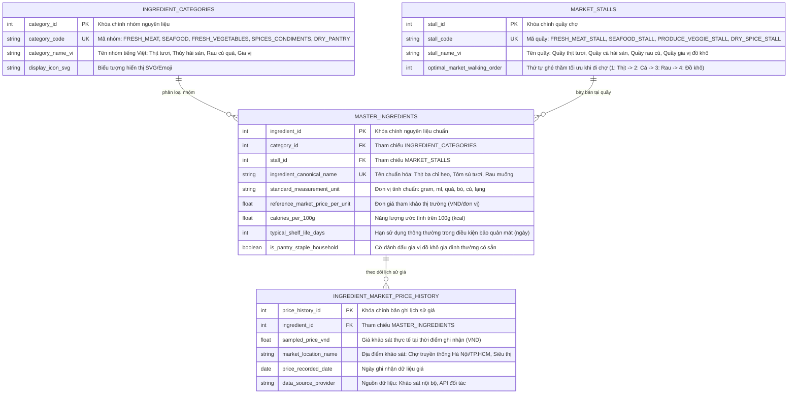
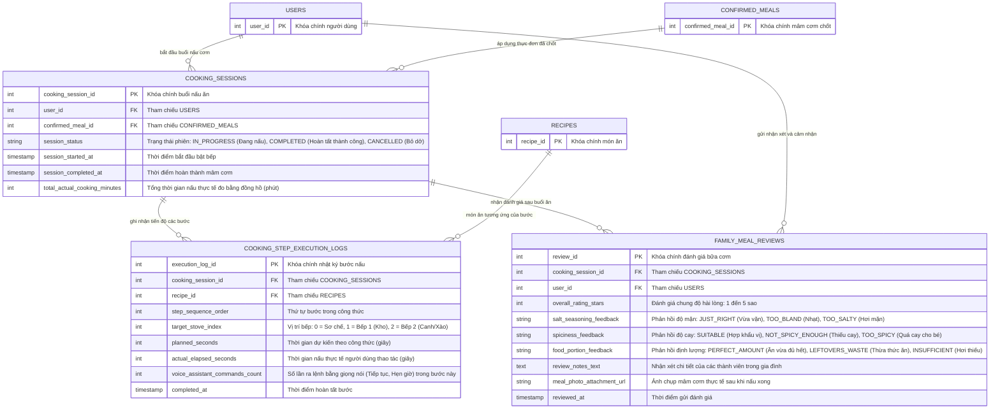

# ĐẶC TẢ CHI TIẾT 7 PHÂN HỆ CƠ SỞ DỮ LIỆU & ERD TỪNG PHẦN
# DỰ ÁN: "HÔM NAY ĂN GÌ?" (DAILYMEAL / SMARTKITCHEN)

> **Mục tiêu:** Tách riêng từng phân hệ chức năng, mỗi phân hệ có một sơ đồ ERD độc lập, kèm từ điển dữ liệu (Data Dictionary) với tên bảng và tên thuộc tính chuẩn hóa tiếng Anh, rõ nghĩa và phản ánh chính xác nghiệp vụ thực tế.

---

## 1. PHÂN HỆ 1: QUẢN LÝ NGƯỜI DÙNG, PHÂN QUYỀN & HỒ SƠ GIA ĐÌNH (IDENTITY & FAMILY PROFILES)

### 1.1. Mục tiêu nghiệp vụ
- Quản lý tài khoản người dùng và nhóm đối tượng nấu ăn (`family`, `student`, `indecisive_eater`).
- Phân quyền hệ thống theo tiêu chuẩn RBAC (Role-Based Access Control) với $\ge 2$ nhóm quyền (`ADMIN`, `CONTENT_EDITOR`, `GENERAL_USER`).
- Quản lý thành viên gia đình đa thế hệ, tỷ lệ khẩu phần ăn (`portion_consumption_ratio`) và sở thích độ cay/mặn/rau.

### 1.2. Sơ đồ ERD Phân hệ 1

---

## 2. PHÂN HỆ 2: AN TOÀN DINH DƯỠNG, CẢNH BÁO DỊ ỨNG & SỨC KHỎE (DIETARY SAFETY & ALLERGENS)

### 2.1. Mục tiêu nghiệp vụ
- Chuẩn hóa danh mục các chất gây dị ứng phổ biến theo quy chuẩn quốc tế.
- Thiết lập hồ sơ dị ứng cho từng thành viên trong gia đình kèm mức độ nghiêm trọng (`MILD`, `MODERATE`, `SEVERE_ANAPHYLAXIS`).
- Gắn nhãn dị ứng vào từng công thức món ăn để động cơ gợi ý lọc cứng tuyệt đối, bảo đảm an toàn tính mạng.

### 2.2. Sơ đồ ERD Phân hệ 2

---

## 3. PHÂN HỆ 3: DANH MỤC NGUYÊN LIỆU & QUẦY CHỢ VIỆT NAM (MASTER INGREDIENTS & MARKET STALLS)

### 3.1. Mục tiêu nghiệp vụ
- Phân cấp nguyên liệu theo danh mục cha-con (`ingredient_categories`).
- Mô phỏng sơ đồ 4 quầy chợ truyền thống Việt Nam (`market_stalls`) với thứ tự đi chợ tối ưu (`optimal_market_walking_order`).
- Quản lý danh mục nguyên liệu gốc (`master_ingredients`) và lưu trữ lịch sử biến động giá thị trường (`ingredient_market_price_history`) — bảng dữ liệu lớn $\ge 10.000$ dòng phục vụ thống kê Big Data.

### 3.2. Sơ đồ ERD Phân hệ 3

---

## 4. PHÂN HỆ 4: KHO CÔNG THỨC MÓN ĂN & CẨM NANG CỨU MÓN (RECIPE CATALOG & EMERGENCY RESCUE)

### 4.1. Mục tiêu nghiệp vụ
- Lưu trữ công thức món ăn chuẩn cơm nhà Việt Nam với đầy đủ nhãn dinh dưỡng định tính (`fat_content_level`, `salt_sodium_level`, `cooking_method`, `primary_protein_type`).
- Định lượng nguyên liệu chi tiết cho 1 suất ăn (`recipe_ingredients`).
- Trục các bước nấu ăn (`recipe_cooking_steps`) gắn liền với Bếp 1, Bếp 2 và điểm trích nhánh nêm gia vị cho bé/người già (`is_family_branching_point`).
- Cẩm nang cứu món khẩn cấp (`recipe_emergency_rescue_tips`) khi món bị mặn, cay, cháy, nhạt.

### 4.2. Sơ đồ ERD Phân hệ 4

```mermaid
erDiagram
    RECIPES ||--o{ RECIPE_INGREDIENTS : "được cấu thành từ"
    MASTER_INGREDIENTS ||--o{ RECIPE_INGREDIENTS : "tham gia vào công thức"
    RECIPES ||--o{ RECIPE_COOKING_STEPS : "chia thành các bước nấu"
    RECIPES ||--o{ RECIPE_EMERGENCY_RESCUE_TIPS : "có cẩm nang giải cứu"
    USERS ||--o{ USER_FAVORITE_RECIPES : "ghim món ruột"
    RECIPES ||--o{ USER_FAVORITE_RECIPES : "được người dùng yêu thích"

    RECIPES {
        int recipe_id PK "Khóa chính công thức món ăn"
        int creator_user_id FK "Tham chiếu người tạo / biên tập USERS"
        string dish_title_vi "Tên món ăn: Cá bống kho tộ, Canh bí đỏ tôm thịt, Rau muống xào tỏi"
        string dish_meal_slot "Vị trí trong mâm cơm: MAIN_SAVORY (Mặn), SOUP (Canh), SIDE_VEGGIE (Rau/Xào)"
        string cooking_method "Cách chế biến chính: BRAISED (Kho), STIR_FRIED (Xào), BOILED_STEAMED (Luộc/Hấp), DEEP_FRIED (Chiên/Rán), SOUP_BOILED (Nấu canh)"
        int fat_content_level "Mức độ béo: 1 = Thấp, 2 = Vừa phải, 3 = Rất béo / Chiên ngập dầu"
        int salt_sodium_level "Mức độ mặn: 1 = Nhạt, 2 = Vừa vặn, 3 = Đậm đà / Mặn kho quẹt"
        string primary_protein_type "Loại đạm chính: PORK, BEEF, CHICKEN, FISH, SEAFOOD, EGG, TOFU, VEGETARIAN"
        boolean is_soft_textured "Món có kết cấu mềm tự nhiên (hợp người già, trẻ nhỏ)"
        boolean has_soft_variant "Có biến thể nấu mềm thay thế"
        boolean has_separable_seasoning "Nêm tách được (nấu nhạt, chấm mắm ớt riêng ngoài)"
        boolean is_spicy_dish "Món có vị cay"
        boolean has_separable_chili "Ớt có thể để riêng không nấu lẫn"
        boolean has_small_bones_risk "Món có nguy cơ xương dăm (cần lưu ý trẻ nhỏ)"
        boolean has_high_sugar_content "Món có hàm lượng đường cao (>1 thìa canh/suất)"
        int estimated_cooking_time_minutes "Thời gian nấu ước tính (phút)"
        int calories_kcal "Năng lượng ước tính trên 1 suất (kcal)"
        float protein_grams "Hàm lượng Protein (g)"
        float carbohydrate_grams "Hàm lượng Carbohydrate (g)"
        float fat_grams "Hàm lượng Lipid/Fat (g)"
        text sodium_reduction_advice "Mẹo cắt giảm muối natri khi nêm"
        text child_friendly_portion_tip "Chỉ dẫn trích phần ăn cho bé trước khi nêm cay"
        text adult_flavor_boost_tip "Chỉ dẫn nêm đậm đà cho người lớn"
        string publication_status "Trạng thái kiểm duyệt: PUBLISHED, PENDING_REVIEW, DRAFT"
    }

    RECIPE_INGREDIENTS {
        int recipe_ingredient_id PK "Khóa chính nguyên liệu công thức"
        int recipe_id FK "Tham chiếu RECIPES"
        int ingredient_id FK "Tham chiếu MASTER_INGREDIENTS"
        float amount_per_single_serving "Định lượng nguyên liệu cho đúng 1 suất ăn"
        string cooking_recipe_unit "Đơn vị nấu trong bếp: gram, ml, thìa cà phê, quả"
        string common_market_purchase_unit "Đơn vị mua thực tế tại chợ: 1 bó, 2 lạng, 1 củ"
        boolean is_optional_ingredient "Nguyên liệu tùy chọn, có thể bỏ qua nếu thiếu"
        string ingredient_preparation_note "Chỉ dẫn sơ chế: Băm nhuyễn, thái lát mỏng, đập dập"
    }

    RECIPE_COOKING_STEPS {
        int step_id PK "Khóa chính bước nấu ăn"
        int recipe_id FK "Tham chiếu RECIPES"
        int step_sequence_order "Thứ tự bước: 1, 2, 3..."
        string step_heading "Tiêu đề bước: Sơ chế, Đảo săn, Kho liu riu"
        text step_instruction_detail "Nội dung chỉ dẫn chi tiết (ngắn gọn, trực quan, <= 25 từ)"
        int estimated_duration_seconds "Thời gian thực hiện bước tính bằng giây"
        int target_stove_index "Vị trí thực hiện: 0 = Bàn sơ chế, 1 = Bếp 1, 2 = Bếp 2"
        boolean is_family_branching_point "Cờ đánh dấu thời điểm múc phần ăn cho trẻ em/người già"
    }

    RECIPE_EMERGENCY_RESCUE_TIPS {
        int rescue_tip_id PK "Khóa chính mẹo cứu món"
        int recipe_id FK "Tham chiếu RECIPES"
        string problem_type "Loại sự cố: TOO_SALTY (Quá mặn), TOO_SPICY (Quá cay), BURNT_BOTTOM (Cháy đáy), TOO_BLAND (Nhạt nhẽo), OILY_GREASY (Nhiều dầu)"
        string symptom_description "Biểu hiện nhận biết lỗi khi đang nấu"
        text emergency_solution_action "Hành động giải cứu khẩn cấp từng bước"
    }

    USER_FAVORITE_RECIPES {
        int favorite_id PK "Khóa chính món ruột ghim"
        int user_id FK "Tham chiếu USERS"
        int recipe_id FK "Tham chiếu RECIPES"
        timestamp marked_favorite_at "Thời điểm ghim món ruột"
    }

    MASTER_INGREDIENTS {
        int ingredient_id PK "Khóa chính nguyên liệu"
        string ingredient_canonical_name "Tên nguyên liệu"
    }

    USERS {
        int user_id PK "Khóa chính người dùng"
        string full_name "Họ tên người dùng"
    }
```

---

## 5. PHÂN HỆ 5: MÂM CƠM & ĐỘNG CƠ GỢI Ý SIÊU TỐC (MEAL COMBOS & RECOMMENDATION LOGS)

### 5.1. Mục tiêu nghiệp vụ
- Quản lý các combo mâm cơm Việt hoàn chỉnh 3 món (`meal_combos` và `meal_combo_recipes`).
- Nhật ký toàn diện của thuật toán gợi ý (`recommendation_session_logs`) phục vụ đo lường KPI chốt $< 30$ giây, theo dõi số lượt đổi món và việc kích hoạt Mood Pivot 4 chip giải cứu.
- Ghi nhận lịch sử các mâm cơm đã chốt (`confirmed_meals`) làm dữ liệu đầu vào cho luật chống lặp 7–14 ngày (M2) và cân bằng dinh dưỡng ngầm 3 bữa (M5).

### 5.2. Sơ đồ ERD Phân hệ 5

```mermaid
erDiagram
    MEAL_COMBOS ||--o{ MEAL_COMBO_RECIPES : "liên kết các món ăn trong mâm"
    RECIPES ||--o{ MEAL_COMBO_RECIPES : "đóng vai trò mặn canh rau"
    USERS ||--o{ RECOMMENDATION_SESSION_LOGS : "thực hiện phiên gợi ý"
    USERS ||--o{ CONFIRMED_MEALS : "chốt thực đơn bữa ăn"
    MEAL_COMBOS ||--o{ CONFIRMED_MEALS : "được chọn chốt"
    RECIPES ||--o{ CONFIRMED_MEALS : "ghi nhận từng món được chốt"

    MEAL_COMBOS {
        int meal_combo_id PK "Khóa chính mâm cơm hoàn chỉnh"
        string combo_display_title "Tên mâm: Mâm 1 · Đậm đà truyền thống, Mâm 2 · Thanh mát ngày hè"
        string thematic_tag "Nhãn chủ đề: Hợp cả nhà, Thanh mát nhẹ bụng, Siêu tốc 25 phút"
        string thematic_gradient_color "Mã màu gradient đại diện cho mâm"
        string photo_emoji_icon "Biểu tượng minh họa: 🍲, 🥗, 🍛"
        int total_cook_time_minutes "Tổng thời gian nấu toàn mâm (phút)"
        float estimated_total_cost_vnd "Tổng chi phí ước tính toàn mâm (VND)"
        int algorithm_match_score_percentage "Độ phù hợp thuật toán tính toán (0 - 100%)"
        boolean is_active_catalog "Trạng thái mâm đang được mở hiển thị"
        timestamp created_at "Thời điểm tạo mâm cơm"
    }

    MEAL_COMBO_RECIPES {
        int combo_recipe_id PK "Khóa chính món trong mâm"
        int meal_combo_id FK "Tham chiếu MEAL_COMBOS"
        int recipe_id FK "Tham chiếu RECIPES"
        string slot_role "Vai trò món: MAIN_SAVORY (Mặn), SOUP (Canh), SIDE_VEGGIE (Rau/Xào)"
    }

    RECOMMENDATION_SESSION_LOGS {
        int session_log_id PK "Khóa chính phiên gợi ý"
        int user_id FK "Tham chiếu USERS"
        text applied_filters_context_json "JSON lưu ngữ cảnh lọc: số suất, thời gian tối đa, ngân sách, mood"
        text suggested_combos_payload_json "JSON lưu danh sách 3 mâm cơm đã gợi ý cho người dùng"
        int decision_duration_seconds "Thời gian người dùng suy nghĩ từ mở app đến chốt (Đo KPI < 30s)"
        int swap_count_performed "Số lần người dùng bấm đổi món trong phiên"
        boolean is_mood_pivot_triggered "Có bị hết 3 lượt đổi và kích hoạt Mood Pivot hay không"
        string selected_mood_pivot_type "Chip vị giác được chọn: SOUR_SPICY, LIGHT_CLEAR, ULTRA_FAST, CHILDHOOD_FAVORITE"
        timestamp logged_at "Thời điểm thực hiện phiên"
    }

    CONFIRMED_MEALS {
        int confirmed_meal_id PK "Khóa chính mâm cơm đã chốt"
        int user_id FK "Tham chiếu người dùng USERS"
        int meal_combo_id FK "Tham chiếu MEAL_COMBOS (có thể null nếu đổi món lẻ)"
        int main_dish_recipe_id FK "Tham chiếu món mặn RECIPES"
        int soup_dish_recipe_id FK "Tham chiếu món canh RECIPES"
        int side_dish_recipe_id FK "Tham chiếu món rau RECIPES"
        int family_servings_count "Số suất ăn thực tế được chốt (1, 2, 4, 6 người)"
        int decision_completion_time_seconds "Thời gian chốt mâm thực tế"
        string meal_plan_status "Trạng thái thực đơn: PLANNED (Đã lên kế hoạch), COOKED_COMPLETED (Đã nấu xong), CANCELLED_SKIPPED (Bỏ qua)"
        timestamp confirmed_at "Thời điểm người dùng bấm CHỐT MÂM"
    }

    USERS {
        int user_id PK "Khóa chính tài khoản"
        string full_name "Họ và tên"
    }

    RECIPES {
        int recipe_id PK "Khóa chính công thức"
        string dish_title_vi "Tên món ăn"
    }
```

---

## 6. PHÂN HỆ 6: QUẢN LÝ ĐI CHỢ & GIẢI CỨU TỦ LẠNH (SMART GROCERY & PANTRY / RESCUE FRIDGE)

### 6.1. Mục tiêu nghiệp vụ
- Tự động sinh danh sách đi chợ từ mâm cơm đã chốt (`grocery_shopping_lists`).
- Gộp định lượng nguyên liệu trùng lặp của cả mâm, phân chia mặt hàng theo sơ đồ 4 quầy chợ truyền thống (`grocery_shopping_items`).
- Quản lý kho thực phẩm trong tủ lạnh gia đình (`fridge_inventory_items`) và xếp hạng nguyên liệu sắp hết hạn.
- Ghi nhận các sự kiện giải cứu đồ tủ lạnh (`fridge_food_rescue_events`) và ước tính số tiền tiết kiệm được.

### 6.2. Sơ đồ ERD Phân hệ 6

```mermaid
erDiagram
    CONFIRMED_MEALS ||--o{ GROCERY_SHOPPING_LISTS : "sinh ra danh sách đi chợ"
    USERS ||--o{ GROCERY_SHOPPING_LISTS : "sở hữu chuyến đi chợ"
    GROCERY_SHOPPING_LISTS ||--o{ GROCERY_SHOPPING_ITEMS : "chứa các mặt hàng cần mua"
    MASTER_INGREDIENTS ||--o{ GROCERY_SHOPPING_ITEMS : "tham chiếu nguyên liệu chuẩn"
    MARKET_STALLS ||--o{ GROCERY_SHOPPING_ITEMS : "phân loại mua tại quầy"
    USERS ||--o{ FRIDGE_INVENTORY_ITEMS : "quản lý thực phẩm trong tủ lạnh"
    MASTER_INGREDIENTS ||--o{ FRIDGE_INVENTORY_ITEMS : "loại thực phẩm"
    USERS ||--o{ FRIDGE_FOOD_RESCUE_EVENTS : "thực hiện sự kiện cứu đồ"
    FRIDGE_INVENTORY_ITEMS ||--o{ FRIDGE_FOOD_RESCUE_EVENTS : "mặt hàng được giải cứu"
    RECIPES ||--o{ FRIDGE_FOOD_RESCUE_EVENTS : "món ăn được nấu từ đồ giải cứu"

    GROCERY_SHOPPING_LISTS {
        int shopping_list_id PK "Khóa chính chuyến đi chợ"
        int user_id FK "Tham chiếu USERS"
        int confirmed_meal_id FK "Tham chiếu CONFIRMED_MEALS"
        string list_title "Tiêu đề: Đi chợ bữa tối 12/10 cho 4 người"
        float total_estimated_budget_vnd "Tổng ngân sách dự kiến (VND)"
        float total_actual_spent_vnd "Tổng số tiền thực tế đã chi tiêu (VND)"
        boolean is_shopping_completed "Trạng thái đã hoàn thành chuyến đi chợ"
        timestamp created_at "Thời điểm tạo danh sách"
    }

    GROCERY_SHOPPING_ITEMS {
        int shopping_item_id PK "Khóa chính mặt hàng đi chợ"
        int shopping_list_id FK "Tham chiếu GROCERY_SHOPPING_LISTS"
        int ingredient_id FK "Tham chiếu MASTER_INGREDIENTS"
        int stall_id FK "Tham chiếu MARKET_STALLS"
        string item_display_name "Tên mặt hàng: Cá bống tươi, Bí đỏ, Tỏi khô (gộp 3 món)"
        string aggregated_quantity_string "Định lượng mua gộp thực tế: 400g, 1 bó, 3 củ"
        float estimated_item_price_vnd "Giá tiền dự kiến của mặt hàng"
        boolean is_checked_in_cart "Đã nhặt hàng vào làn/giỏ đi chợ"
        boolean is_already_available_in_fridge "Đã có sẵn trong tủ lạnh (không cần mua thêm)"
    }

    FRIDGE_INVENTORY_ITEMS {
        int fridge_item_id PK "Khóa chính thực phẩm trong tủ"
        int user_id FK "Tham chiếu USERS"
        int ingredient_id FK "Tham chiếu MASTER_INGREDIENTS"
        string custom_item_label "Tên tự đặt: Thịt ba chỉ mua hôm qua, 2 quả trứng gà ta"
        float current_quantity_amount "Số lượng thực phẩm hiện có"
        string measurement_unit "Đơn vị tính: gram, kg, quả, phần"
        date stored_date "Ngày bắt đầu lưu trữ vào tủ lạnh"
        date expiration_date "Ngày hết hạn sử dụng ước tính"
        string freshness_status "Trạng thái độ tươi: FRESH_GOOD (Tươi ngon), EXPIRING_SOON_WARNING (Sắp hết hạn trong 48h), EXPIRED (Đã quá hạn)"
        boolean is_rescued_into_meal "Đã được đưa vào mâm cơm để nấu"
        timestamp created_at "Thời điểm nhập vào hệ thống"
    }

    FRIDGE_FOOD_RESCUE_EVENTS {
        int rescue_event_id PK "Khóa chính sự kiện giải cứu thực phẩm"
        int user_id FK "Tham chiếu USERS"
        int fridge_item_id FK "Tham chiếu FRIDGE_INVENTORY_ITEMS"
        int recipe_id FK "Tham chiếu RECIPES"
        float rescued_weight_grams "Khối lượng thực phẩm giải cứu thành công (gram)"
        float estimated_money_saved_vnd "Số tiền ước tính tiết kiệm được không bị lãng phí (VND)"
        timestamp rescued_at "Thời điểm giải cứu thành công"
    }

    CONFIRMED_MEALS {
        int confirmed_meal_id PK "Khóa chính mâm cơm"
    }
    USERS {
        int user_id PK "Khóa chính người dùng"
    }
    MASTER_INGREDIENTS {
        int ingredient_id PK "Khóa chính nguyên liệu"
    }
    MARKET_STALLS {
        int stall_id PK "Khóa chính quầy chợ"
    }
    RECIPES {
        int recipe_id PK "Khóa chính công thức"
    }
```

---

## 7. PHÂN HỆ 7: TRỢ LÝ NẤU ĂN SONG SONG & ĐÁNH GIÁ BỮA CƠM (PARALLEL COOKING & MEAL REVIEWS)

### 7.1. Mục tiêu nghiệp vụ
- Điều phối phiên nấu ăn thực tế (`cooking_sessions`) theo trục timeline song song 2 bếp (giảm thời gian từ 60p xuống 25–30p).
- Ghi nhận chi tiết thời gian thực thi từng bước trên từng bếp và số lần gọi lệnh giọng nói rảnh tay (`cooking_step_execution_logs`).
- Thu thập phản hồi, đánh giá chất lượng bữa cơm gia đình (`family_meal_reviews`) về độ mặn, độ cay, lượng ăn để cá nhân hóa cho các lần gợi ý tiếp theo.

### 7.2. Sơ đồ ERD Phân hệ 7

