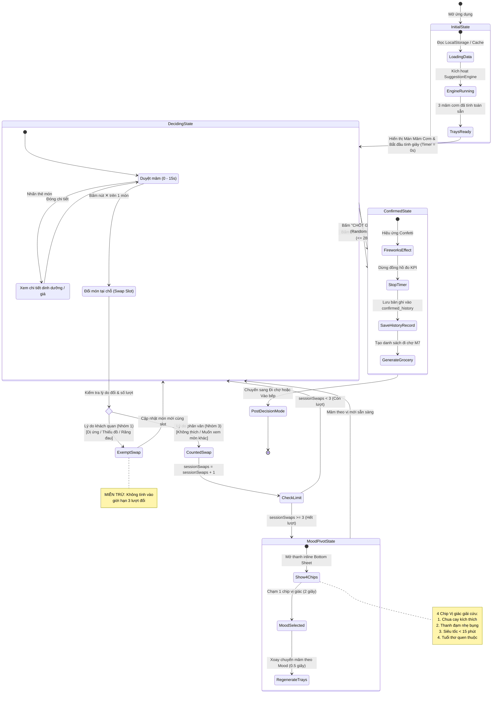
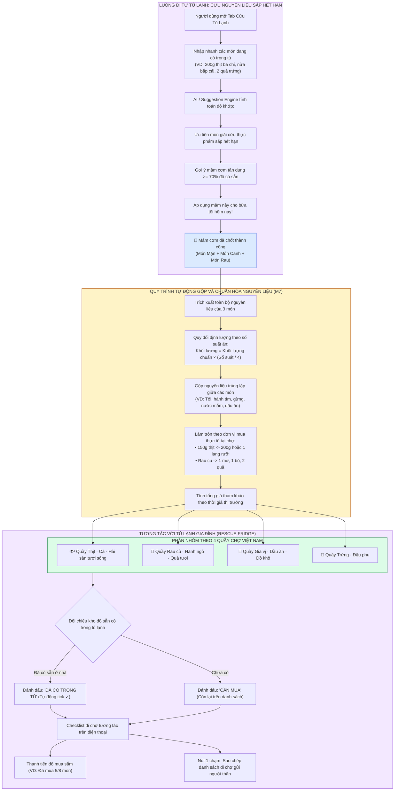
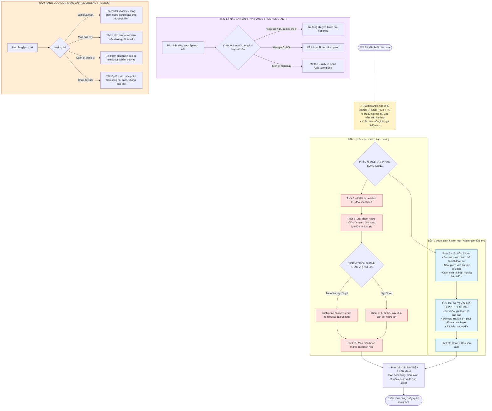
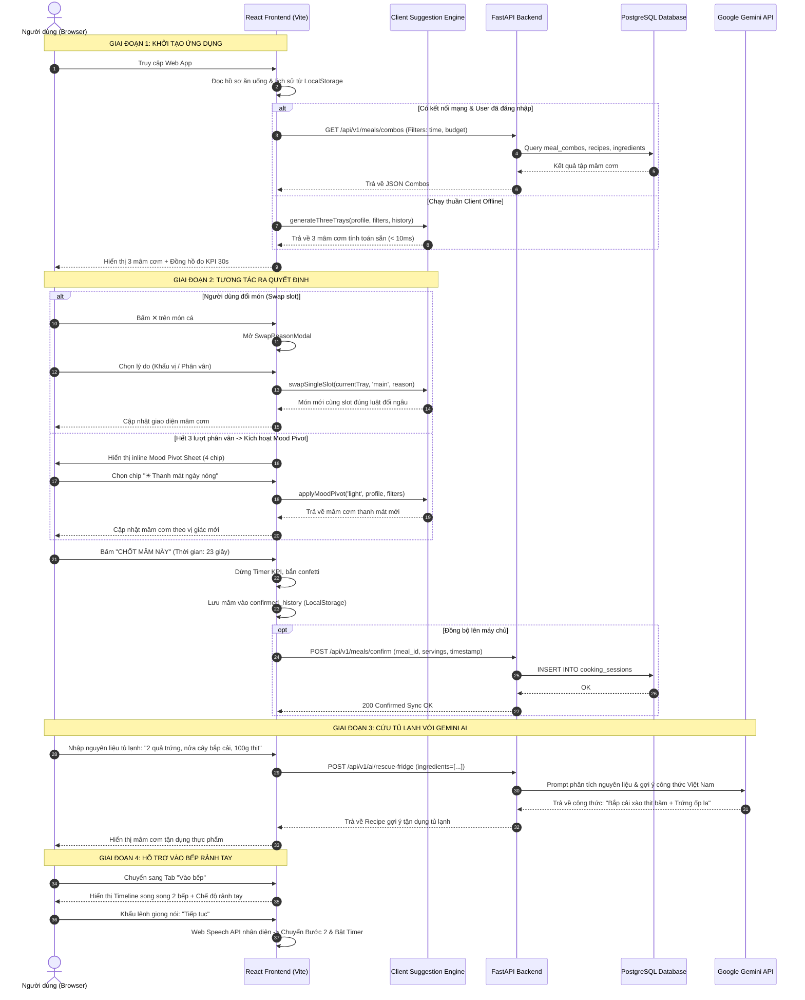
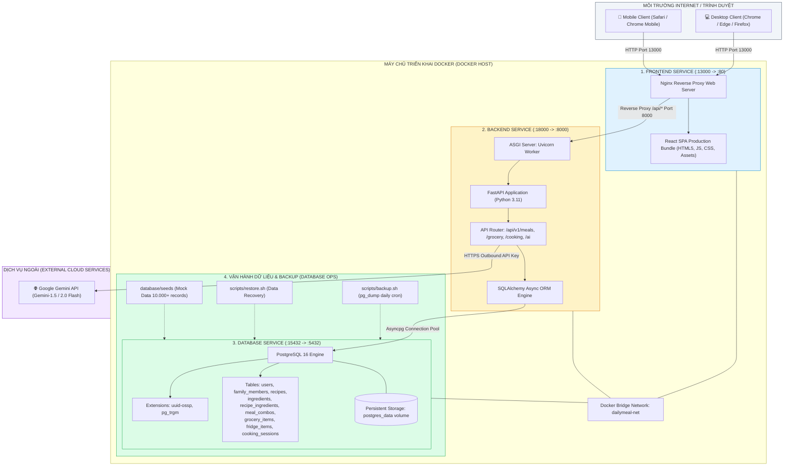

# ĐẶC TẢ CHI TIẾT WORKFLOW DỰ ÁN "HÔM NAY ĂN GÌ?" (DAILYMEAL / SMARTKITCHEN)

> **Dự án:** Web App "Hôm Nay Ăn Gì?" – Trợ lý lập mâm cơm gia đình và điều phối nấu ăn thông minh  
> **Học phần:** Cơ sở dữ liệu Web & Hệ thống thông tin / Đồ án Chuyên ngành Công nghệ phần mềm  
> **Kiến trúc:** React + TailwindCSS (Frontend) | FastAPI (Backend) | PostgreSQL 16 (Database) | Gemini AI Integration  

---

## MỤC LỤC TỔNG QUAN HỆ THỐNG WORKFLOW

1. [Workflow 1: Hành trình người dùng khép kín (End-to-End User Journey)](#1-workflow-1-hành-trình-người-dùng-khép-kín-end-to-end-user-journey)
2. [Workflow 2: Thuật toán gợi ý mâm cơm & Cân bằng dinh dưỡng (Suggestion Engine Logic)](#2-workflow-2-thuật-toán-gợi-ý-mâm-cơm--cân-bằng-dinh-dưỡng-suggestion-engine-logic)
3. [Workflow 3: State Machine - Vòng đời ra quyết định < 30s & Cơ chế giải cứu phân vân](#3-workflow-3-state-machine---vòng-đời-ra-quyết-định--30s--cơ-chế-giải-cứu-phân-vân)
4. [Workflow 4: Luồng Đi chợ thông minh & Cứu tủ lạnh (Smart Grocery & Fridge Rescue)](#4-workflow-4-luồng-đi-chợ-thông-minh--cứu-tủ-lạnh-smart-grocery--fridge-rescue)
5. [Workflow 5: Điều phối vào bếp song song & Trợ lý rảnh tay (Parallel Cooking & Hands-free)](#5-workflow-5-điều-phối-vào-bếp-song-song--trợ-lý-rảnh-tay-parallel-cooking--hands-free)
6. [Workflow 6: Sequence Diagram - Tương tác hệ thống kỹ thuật Full-Stack](#6-workflow-6-sequence-diagram---tương-tác-hệ-thống-kỹ-thuật-full-stack)
7. [Workflow 7: Kiến trúc hạ tầng & Luồng triển khai Docker Container](#7-workflow-7-kiến-trúc-hạ-tầng--luồng-triển-khai-docker-container)

---

## 1. WORKFLOW 1: HÀNH TRÌNH NGƯỜI DÙNG KHÉP KÍN (END-TO-END USER JOURNEY)

Biểu đồ mô tả trọn vẹn vòng đời trải nghiệm của người dùng từ khi mở ứng dụng, giải quyết bài toán tê liệt lựa chọn, đi chợ theo quầy, nấu song song và ghi nhận dữ liệu cho các bữa ăn tiếp theo.

```mermaid
flowchart TD
    Start(["🚀 Người dùng mở Web App"]) --> CheckOnboarding{"Lần đầu truy cập?"}
    
    %% Khâu 1: Onboarding
    CheckOnboarding -- "Có" --> Onboard["📝 Onboarding 1 chạm:<br>Chọn đối tượng nấu (Gia đình / Sinh viên / Phân vân)"]
    Onboard --> SaveProfile["Lưu Hồ sơ ăn uống & Khẩu vị ban đầu"]
    SaveProfile --> GenTray
    CheckOnboarding -- "Không" --> LoadSaved["Đọc Cache & Trạng thái từ LocalStorage"]
    LoadSaved --> GenTray

    %% Khâu 2: Ra quyết định mâm cơm (< 30s)
    subgraph S1 ["GIAI ĐOẠN 1: RA QUYẾT ĐỊNH SIÊU TỐC (< 30s)"]
        GenTray["🧠 Suggestion Engine chạy ngầm:<br>Sinh 3 combo mâm cơm Việt chuẩn vị"]
        GenTray --> DisplayTrays["Hiển thị 3 mâm cơm (Mặn + Canh + Rau)<br>Kèm đồng hồ đếm ngược KPI 30s"]
        DisplayTrays --> UserAction{"Hành động người dùng"}
        
        UserAction -- "Ưng ý ngay" --> ConfirmMeal["✅ Bấm CHỐT MÂM NÀY"]
        UserAction -- "Phân vân / Không thích 1 món" --> SwapSlot["Bấm ✕ đổi 1 món đơn lẻ"]
        UserAction -- "Ngại nghĩ hoàn toàn" --> RandomPick["🎲 Bấm CHỐT GIÚP TÔI"]
        RandomPick --> ConfirmMeal
        
        SwapSlot --> CheckSwapLimit{"Số lượt đổi trong phiên?"}
        CheckSwapLimit -- "< 3 lượt" --> DoSwap["Xoay đổi món khác cùng slot<br>(Giữ nguyên cấu trúc mâm)"] --> DisplayTrays
        CheckSwapLimit -- ">= 3 lượt" --> MoodPivot["🆘 Kích hoạt MOOD PIVOT GIẢI CỨU<br>(4 Chip: Chua cay / Thanh mát / Cực nhanh / Quen thuộc)"]
        MoodPivot --> SelectMood["Chọn 1 chip cảm giác thèm"] --> GenPivotTray["Tái tạo mâm cơm theo vị giác mới"] --> ConfirmMeal
    end

    ConfirmMeal --> Confetti["🎉 Bắn pháo hoa chúc mừng & Lưu lịch sử 14 ngày"]

    %% Khâu 3: Đi chợ & Tủ lạnh
    subgraph S2 ["GIAI ĐOẠN 2: ĐI CHỢ & QUẢN LÝ TỦ LẠNH"]
        Confetti --> AggGrocery["🛒 Tự động gộp nguyên liệu của cả mâm<br>Quy đổi định lượng theo số suất"]
        AggGrocery --> GroupStalls["Phân loại theo 4 quầy chợ truyền thống:<br>• Thịt/Cá • Rau củ • Gia vị/Đồ khô • Trứng/Đậu"]
        GroupStalls --> CheckFridge["Đối chiếu kho tủ lạnh có sẵn (Rescue Fridge)"]
        CheckFridge --> ShoppingList["Checklist đi chợ tương tác & Ước tính tổng tiền"]
        ShoppingList --> ShareList["📤 Xuất danh sách chia sẻ qua Zalo/Tin nhắn"]
    end

    %% Khâu 4: Nấu ăn & Hài hòa khẩu vị
    subgraph S3 ["GIAI ĐOẠN 3: ĐIỀU PHỐI VÀO BẾP & KHẨU VỊ GIA ĐÌNH"]
        ShoppingList --> CookView["👩‍🍳 Chuyển sang màn hình TRỢ LÝ VÀO BẾP"]
        CookView --> ParallelTimeline["Biểu đồ Timeline song song 2 bếp<br>(Giảm thời gian từ 60p xuống 25-30p)"]
        ParallelTimeline --> HandsFreeMode["Chế độ nấu rảnh tay (Hands-free Step-by-Step)<br>Font chữ lớn + Hẹn giờ Timer + Giọng nói"]
        HandsFreeMode --> BranchFamily["Mô hình Một mâm - Nhiều nhánh:<br>Trích phần ăn trẻ em/người già trước khi nêm cay"]
        HandsFreeMode --> EmergencyRescue["Cẩm nang cứu món khẩn cấp (Mặn/Cay/Cháy/Ngọt)"]
    end

    %% Khâu 5: Kết thúc & Vòng lặp phản hồi
    BranchFamily --> MealDone["🍲 Hoàn tất mâm cơm & Dọn mâm"]
    MealDone --> UpdateHistory["Đồng bộ lịch sử chốt mâm vào CSDL PostgreSQL<br>Cập nhật quy tắc chống lặp cho 7-14 ngày tiếp theo"]
    UpdateHistory --> End(["✨ Kết thúc phiên nấu"])

    classDef stage fill:#f0fdf4,stroke:#16a34a,stroke-width:2px;
    classDef decision fill:#fef3c7,stroke:#d97706,stroke-width:2px;
    classDef action fill:#eff6ff,stroke:#2563eb,stroke-width:2px;
    class S1,S2,S3 stage;
    class CheckOnboarding,UserAction,CheckSwapLimit decision;
    class ConfirmMeal,DoSwap,MoodPivot,AggGrocery,HandsFreeMode action;
```

---

## 2. WORKFLOW 2: THUẬT TOÁN GỢI Ý MÂM CƠM & CÂN BẰNG DINH DƯỠNG (SUGGESTION ENGINE LOGIC)

Engine được thiết kế theo tư duy **Client-side Pure Functions** kết hợp với REST API Backend, bảo đảm tính sẵn sàng offline và phản hồi tức thì dưới 10ms.

```mermaid
flowchart TD
    subgraph Inputs ["DỮ LIỆU ĐẦU VÀO CỦA ENGINE"]
        RawDishes["Kho dữ liệu 110 món cơm Việt<br>(55 Mặn, 30 Canh, 25 Rau)"]
        UserProfile["Hồ sơ bữa ăn gia đình (M6):<br>• Dị ứng thực phẩm<br>• Món mềm (người già)<br>• Ít mặn (cao huyết áp)<br>• Không cay / Ít xương dăm (trẻ nhỏ)<br>• Giảm ngọt/đường"]
        QuickFilters["Bộ lọc nhanh ngữ cảnh (M4):<br>• Số suất (1, 2, 4, 6 người)<br>• Thời gian nấu (15p, 30p, 45p)<br>• Ngân sách (<100k, 100-180k, >200k)<br>• Dụng cụ (Tối giản 1 chảo + nồi cơm)"]
        MealHistory["Lịch sử 14 ngày đã chốt gần nhất (M2)"]
        SessionRejects["Danh sách món đã từ chối trong phiên"]
        FavoritesList["Danh sách món ruột đã ghim"]
    end

    subgraph Step1 ["BƯỚC 1: LỌC CỨNG (HARD FILTERS - KHÔNG BAO GIỜ NỚI LỎNG)"]
        RawDishes --> F1{"Kiểm tra Dị ứng?"}
        F1 -- "Chứa dị nguyên" --> ExcludeAllergen["Loại bỏ vĩnh viễn"]
        F1 -- "Hợp lệ" --> F2{"Hồ sơ sức khỏe đặc thù?"}
        
        F2 --> CheckSoft["Nếu cần mềm: món mặn phải mềm/có biến thể"]
        F2 --> CheckLowSalt["Nếu ít mặn: loại mặn mức 3 không nêm riêng"]
        F2 --> CheckChild["Nếu có trẻ: loại cay/xương dăm không tách được"]
        F2 --> CheckLowSugar["Nếu giảm ngọt: loại món nhiều đường"]
        
        CheckSoft & CheckLowSalt & CheckChild & CheckLowSugar --> F3{"Bộ lọc nhanh?"}
        F3 --> FilterTime["Thời gian <= MaxTime"]
        F3 --> FilterBudget["Giá ước tính <= MaxBudget"]
        F3 --> FilterTools["Dụng cụ phù hợp"]
        FilterTime & FilterBudget & FilterTools --> ValidPool["Tập ứng viên khả dụng ban đầu"]
    end

    subgraph Step2 ["BƯỚC 2: CHẤM ĐIỂM CHỐNG LẶP (M2) & CÂN BẰNG SỨC KHỎE NGẦM (M5)"]
        ValidPool --> InitScore["Gán điểm gốc: Score = 100 điểm cho mỗi món"]
        
        %% Chống lặp
        InitScore --> CheckRepeat{"Kiểm tra Lịch sử chốt (M2)"}
        CheckRepeat -- "Đã chốt trong 1 - 7 ngày" --> Drop7Days["Score = -9999 (Loại bỏ triệt để)"]
        CheckRepeat -- "Đã chốt trong 8 - 14 ngày" --> Penalty14["Trừ 30 điểm"]
        CheckRepeat -- "Món vừa từ chối trong phiên" --> DropSession["Score = -9999 (Loại bỏ)"]
        CheckRepeat -- "Chưa nấu gần đây" --> BalanceCheck
        Penalty14 --> BalanceCheck
        
        %% Cân bằng định tính 3 bữa
        BalanceCheck["Kiểm tra cửa sổ 3 bữa gần nhất (M5)"] --> B1{"Luật Béo & Chiên rán?"}
        B1 -- "Bữa trước béo mức 3" --> FatPenalty["Món béo 3: -40đ | Món béo 1: +15đ"]
        B1 -- ">= 2 món chiên trong 3 bữa" --> FriedDrop["Loại trừ món chiên rán"]
        
        FatPenalty & FriedDrop --> B2{"Luật Đa dạng Đạm?"}
        B2 -- "Trùng đạm bữa gần nhất" --> ProtPenalty1["Trừ 25 điểm"]
        B2 -- "Trùng đạm >= 2 lần trong 3 bữa" --> ProtPenalty2["Trừ 40 điểm"]
        
        ProtPenalty1 & ProtPenalty2 --> B3{"Luật Mặn & Điều vị?"}
        B3 -- ">= 2 món mặn mức 3" --> SaltPenalty["Món mặn 3: -25đ | Canh ưu tiên thanh mát"]
        
        SaltPenalty --> CapPenalty["Áp trần điểm phạt cân bằng: Tối đa -60đ<br>(Món ruột chỉ bị trừ tối đa -20đ)"]
        CapPenalty --> RankMains["Xếp hạng danh sách Món mặn theo Điểm số"]
    end

    subgraph Step3 ["BƯỚC 3: GHÉP CẶP MÂM CƠM VIỆT CHUẨN VỊ (M1)"]
        RankMains --> PickMain["Chọn Món mặn từ Top 5 (Random có trọng số)"]
        PickMain --> PairSoup["Ghép Món Canh theo luật đối ngẫu:<br>• Mặn khô/đậm -> Canh thanh mát / rau ngọt<br>• Mặn có nước sốt -> Canh rau đơn giản<br>• Tuyệt đối không trùng loại đạm chính"]
        PairSoup --> PairVeg["Ghép Món Rau / Xào:<br>• Bảo đảm mâm có >= 1 món rau xanh<br>• Nếu mặn béo 3 -> Rau bắt buộc luộc/hấp"]
        PairVeg --> TrayAssembled["Mâm cơm hoàn chỉnh 3 món:<br>[Món Mặn] + [Món Canh] + [Món Rau]"]
    end

    subgraph Step4 ["BƯỚC 4: SINH 3 PHƯƠNG ÁN MÂM CƠM THEO CHỦ ĐỀ"]
        TrayAssembled --> Tray1["Mâm 1: Đậm đà truyền thống / Chuẩn vị gia đình"]
        TrayAssembled --> Tray2["Mâm 2: Thanh mát nhẹ bụng / Đổi vị"]
        TrayAssembled --> Tray3["Mâm 3: Siêu tốc 20-25 phút / Tối giản"]
    end

    classDef input fill:#f1f5f9,stroke:#64748b;
    classDef filter fill:#fee2e2,stroke:#ef4444;
    classDef scoring fill:#fef9c3,stroke:#ca8a04;
    classDef pairing fill:#e0f2fe,stroke:#0284c7;
    classDef output fill:#dcfce7,stroke:#16a34a;
    class RawDishes,UserProfile,QuickFilters,MealHistory,SessionRejects,FavoritesList input;
    class F1,F2,F3,ExcludeAllergen filter;
    class InitScore,CheckRepeat,BalanceCheck,CapPenalty,RankMains scoring;
    class PickMain,PairSoup,PairVeg,TrayAssembled pairing;
    class Tray1,Tray2,Tray3 output;
```

---

## 3. WORKFLOW 3: STATE MACHINE - VÒNG ĐỜI RA QUYẾT ĐỊNH < 30S & CƠ CHẾ GIẢI CỨU PHÂN VÂN

Sơ đồ trạng thái máy (State Machine) quản lý phiên người dùng, cam kết người phân vân chốt món dưới 30 giây mà không bị rơi vào hội chứng "FOMO nghịch đảo" (Paradox of Choice).

---

## 4. WORKFLOW 4: LUỒNG ĐI CHỢ THÔNG MINH & CỨU TỦ LẠNH (SMART GROCERY & FRIDGE RESCUE)

Cầu nối trực tiếp từ quyết định ăn gì sang hành động thực tế, giúp tiết kiệm chi phí, giảm thời gian lượn lờ chợ và triệt tiêu lãng phí thực phẩm (Food Waste).

---

## 5. WORKFLOW 5: ĐIỀU PHỐI VÀO BẾP SONG SONG & TRỢ LÝ RẢNH TAY (PARALLEL COOKING & HANDS-FREE)

Biểu đồ mô tả trục thời gian song song giữa các bếp và chế độ trợ lý rảnh tay, giúp người nấu hoàn thành mâm cơm 3 món trong 25–30 phút thay vì nấu tuần tự hơn 60 phút.

---

## 6. WORKFLOW 6: SEQUENCE DIAGRAM - TƯƠNG TÁC HỆ THỐNG KỸ THUẬT FULL-STACK

Sơ đồ trình tự biểu diễn giao tiếp dữ liệu giữa Client React, FastAPI Backend, CSDL PostgreSQL và Gemini AI.

---

## 7. WORKFLOW 7: KIẾN TRÚC HẠ TẦNG & LUỒNG TRIỂN KHAI DOCKER CONTAINER

Mô hình triển khai container hóa theo yêu cầu đồ án hệ thống thông tin 2026, bảo đảm phân tách môi trường, an toàn dữ liệu và khả năng mở rộng.

---

## 8. TỔNG KẾT VÀ BẢNG ĐỐI CHIẾU TIÊU CHÍ ĐỒ ÁN

| Phân hệ nghiệp vụ | Thành phần trong Workflow | Module mã nguồn | Giá trị giải quyết |
|---|---|---|---|
| **1. Khám phá & Ra quyết định** | Workflow 1, 2, 3 | `HomePage.jsx`, `suggestionEngine.js`, `meals.py` | Giải quyết tê liệt lựa chọn, ra quyết định < 30 giây, mâm cơm 3 món chuẩn Việt, chống lặp 7-14 ngày. |
| **2. Đi chợ & Tủ lạnh thông minh** | Workflow 1, 4 | `GroceryPage.jsx`, `suggestionEngine.js`, `fridge.py` | Gộp nguyên liệu theo 4 quầy chợ, đối chiếu đồ có sẵn trong tủ, tận dụng đồ sắp hết hạn, chống lãng phí. |
| **3. Trợ lý vào bếp điều phối song song** | Workflow 1, 5 | `CookPage.jsx`, `cooking.py` | Rút ngắn thời gian nấu từ 60p xuống 25-30p nhờ timeline 2 bếp, chế độ rảnh tay giọng nói, cẩm nang cứu món khẩn cấp. |
| **4. Cá nhân hóa & Dinh dưỡng đa thế hệ** | Workflow 1, 2, 5 | `FamilyPage.jsx`, `DietaryProfileModal.jsx`, `models.py` | Mô hình "Một mâm - Nhiều nhánh", bảo vệ người dị ứng, người già ăn nhạt/mềm, trẻ nhỏ không cay. |
| **5. Cơ sở dữ liệu & Kiến trúc hệ thống** | Workflow 6, 7 | `database/init.sql`, `docker-compose.yml`, `models/` | 10 bảng quan hệ chuẩn hóa 3NF, lưu trữ PostgreSQL, triển khai Docker 3 containers độc lập. |
